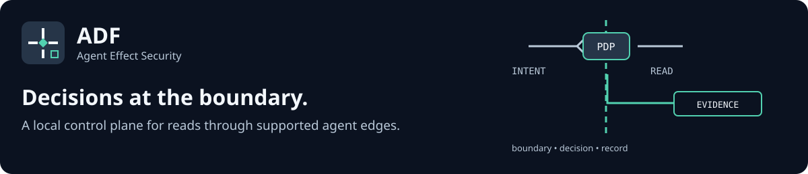
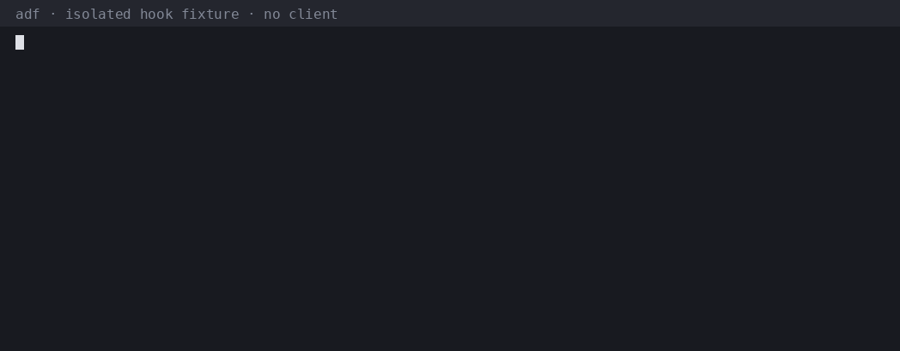
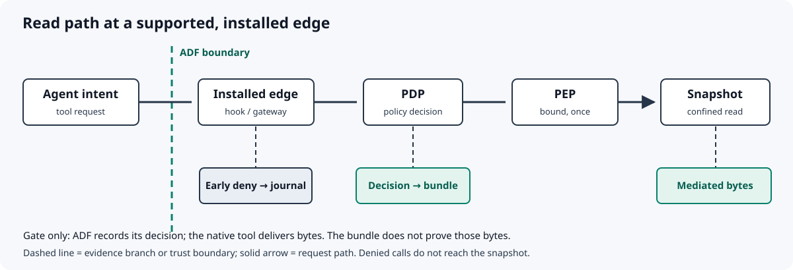
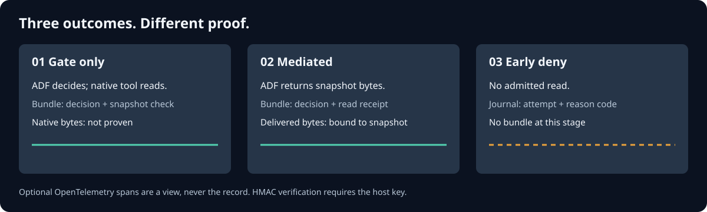

# ADF · Agent Effect Security

**English** · [Português (Brasil)](README.pt-BR.md)


**Decisions at the boundary.** A local control plane for reads through supported, installed agent edges. Experimental `0.x`; this checkout reports its version from [`VERSION`](VERSION).

[](https://github.com/Joaolucas2210/agent-effect-security/actions/workflows/quality-gates.yml) [](https://github.com/Joaolucas2210/agent-effect-security/releases) [](LICENSE)

[Try an isolated decision](#quickstart) · [See coverage](#coverage-today) · [Audit the boundary](docs/product/BOUNDARY.md) · [Report a vulnerability privately](SECURITY.md)



## Why this exists

A coding agent can ask to read `.env` while working on an ordinary repository. Prompts and traces help people understand a session, but they are not the authority for that file access. ADF places a deterministic decision at **specific installed edges**: a host-owned policy limits which reads may proceed, and the result has an explicit evidence path. The host operator, installed ADF code and hook registration remain trusted. [Threat model and six bounded claims](ai-development-framework/docs/architecture-decision-records/0026-threat-model-and-claims.md).

## See it work

In the synthetic fixture behind this demo, `Read README.md` is allowed and `Read .env` is denied with `invalid_scope`. Both requests reach the adapter and produce an Evidence Bundle. A denial by a deny-only gate or an invalid contract can leave **only a journal entry**. The GIF captures the real CLI and hook on a throwaway repository; display paths are substituted, and no real client session is implied. [Reproduction steps](docs/assets/README.md).



## Quickstart

**First, no agent settings:** follow the [isolated quickstart](docs/product/QUICKSTART.md). It creates a temporary Git fixture and `ADF_HOME`, installs the editable package in a venv, calls the real `adf hook` with two synthetic requests, and verifies a bundle with a temporary key. Requirements: Git, Make and Python 3.10+ with `venv`. No public PyPI install is assumed.

```bash
python3 -m venv .venv
source .venv/bin/activate
make install-dev
adf version
# Continue with the synthetic fixture and verification in docs/product/QUICKSTART.md
```

**Then, opt in a real client:** `adf hook-snippet claude` or `adf hook-snippet codex` prints JSON. Review and merge its `hooks.PreToolUse` entries into the client's settings, preserving existing hooks; restart the client; enable a repository with `adf projects enable /absolute/path/to/repo`; then run `adf doctor --pin` after registration. For a real allowlist, build and pin a session policy with `ADF_READ_POLICY_FILE` and `ADF_READ_POLICY_SHA256`. [Full host steps and reversal](docs/product/QUICKSTART.md#opt-in-a-real-client-later).

`make e2e` separately runs a fresh-clone fixture, local edges and trials. It is a contract check, not proof that a particular installed client version invoked its hook.

## How it works



The edge translates an observed request. The **PDP** decides against a host-pinned policy. The **PEP** rechecks bindings at effect time and consumes the decision once. The read runtime opens one regular file in a host-prepared Git snapshot with a byte ceiling and sensitive-path rule. [Architecture](ai-development-framework/docs/CONTROL_PLANE.md) · [policy pack](ai-development-framework/policy-packs/effect-security-read-v0/README.md).

`gate_only` (Claude `Read`, supported `cat` hooks) means ADF decides and checks a snapshot, while the native tool delivers bytes. Its bundle does **not** prove those native bytes. `mediated` (ADF's stdio MCP read and supported A2A path) means ADF returns bytes from its controlled read. Neither mode covers a request that never enters an installed edge.

## Coverage today

This is the implemented surface in this checkout; local fixture tests and real-client observations are different levels of evidence. See [BOUNDARY's support matrix](docs/product/BOUNDARY.md#support-matrix) for grammar, versions and exceptions.

| Edge | Implemented path | Main residual |
| --- | --- | --- |
| Claude Code | `Read` gate; selected `Bash` reads; deny-only gates on selected read, write, network and pinned MCP calls | Other Bash/script/interpreter routes, unobserved subagent tools; client version was not recorded in trials |
| Codex CLI | Hook for supported single `cat PATH`; selected Bash denies | Other commands and MCP calls outside the hook; global hook client version `na` |
| A2A | Loopback `read_workspace_file` gateway, bearer validation and effect-bound decisions | Stolen bearer valid until expiry; no public gateway or DPoP/mTLS |
| MCP | ADF stdio mediated read; Claude hook registry/definition deny gate | Unhooked servers, tool-list drift between probes and unobserved output |

No OS sandbox or universal Bash interception is claimed. An agent with another route to disk can bypass these gates. [Incident coverage map](docs/knowledge/coverage.md).

## What evidence proves



- **Evidence Bundle:** a composed decision, bindings and read receipt, without file content. `delivery_mode` states whether ADF delivered bytes (`mediated`) or only gated a native tool (`gate_only`). A denied request before composition may have no bundle.
- **Attempt journal:** a hash-chained local record for pre-adapter and deny-only attempts. It records a reason, not a verified read receipt; a missing hook leaves no ADF record.
- **OpenTelemetry:** optional, redacted correlation view. A missing span does not change admission and a span is not authorization evidence.

`adf verify FILE` checks structure and digests offline and reports `authenticity=not_checked`. `adf verify FILE --key HOST_KEY` also checks a **shared-secret HMAC**. This authenticates against that host key, not to an independent public verifier; do not share the key with an external auditor. Evidence can still expose metadata such as IDs and repository-relative scopes, so review it before sharing. [Evidence boundary](docs/product/BOUNDARY.md#evidence-is-the-record-telemetry-only-visualizes) · [HMAC decision](ai-development-framework/docs/architecture-decision-records/0030-evidence-authenticity-host-key.md).

## Security boundary

The host operator must protect hook registration, the project opt-in list, policy pins and the evidence key. If the supplied wrapper cannot find the `adf` executable, it exits **without a decision**; `adf hook` also suppresses unexpected exceptions. The client may then proceed under its own permissions. ADF does not claim global fail-closed behavior. Even an enabled project's in-process deny does not contain arbitrary code outside the observed edge. [Threat model](ai-development-framework/docs/architecture-decision-records/0026-threat-model-and-claims.md) · [boundary and trust assumptions](docs/product/BOUNDARY.md) · [private disclosure](SECURITY.md).

## Status and next steps

The repository is experimental `0.x`. The read effect and selected deny-only gates are implemented; the maintainer's host pilot is experimental, and the write effect remains a [blocked proposal](ai-development-framework/docs/architecture-decision-records/0032-write-effect-admit-path.md) awaiting design-partner demand. The agent-development harness in `ai-development-framework/` helps build ADF but is outside its enforcement boundary. [Roadmap](docs/product/ROADMAP.md) · [changelog](CHANGELOG.md).

## Documentation and contribution

- **Integrate:** [isolated quickstart](docs/product/QUICKSTART.md), [host/trial guide](ai-development-framework/docs/trials.md), [policy pack](ai-development-framework/policy-packs/effect-security-read-v0/README.md).
- **Operate and verify:** [boundary](docs/product/BOUNDARY.md), [control plane](ai-development-framework/docs/CONTROL_PLANE.md), [threats and claims](ai-development-framework/docs/architecture-decision-records/0026-threat-model-and-claims.md), [OSPS Baseline self-assessment](docs/security/OSPS-BASELINE-2026-08-28.md).
- **Contribute:** [CONTRIBUTING](CONTRIBUTING.md), [Code of Conduct](CODE_OF_CONDUCT.md), [MIT license](LICENSE), [brand assets](docs/brand/BRAND_GUIDELINES.md).
- **Report a flaw:** use the [private security reporting route](SECURITY.md); do not open a public issue with secrets.
