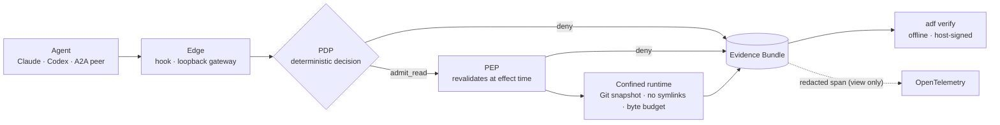
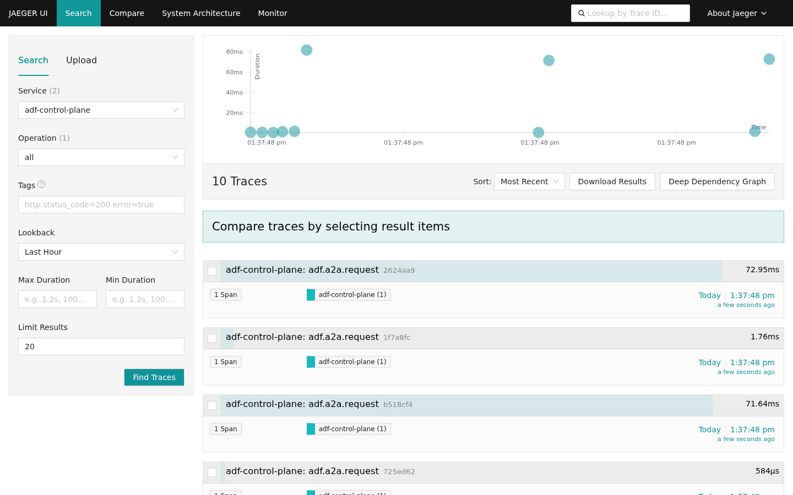

<div align="center">

# ADF

**Agent effect security: a local control plane for coding agents**

**English** · [Português (Brasil)](README.pt-BR.md)

[](https://github.com/Joaolucas2210/agent-effect-security/actions/workflows/quality-gates.yml)
[](https://github.com/Joaolucas2210/agent-effect-security/releases)


[](LICENSE)

Coding agents read `.env` as easily as `README.md`.<br>
ADF decides every read before it happens, enforces the decision at the moment of the effect,<br>
and leaves evidence that anyone can verify offline — no LLM, no network, no trust in ADF's own logs.

**Deterministic · Offline-verifiable · Least privilege · Evidence, not telemetry**

[Why](#why-adf-exists) · [How it works](#how-it-works) · [Quickstart](#quickstart) · [Coverage](#coverage-and-limits) · [Evidence](#evidence-not-telemetry) · [Security model](#security-model-and-threat-model) · [Status](#status-and-roadmap) · [Docs](#documentation)

</div>


<sup>Every line above is captured from the real CLI and the real hook; [how the GIF is made](docs/assets/README.md).</sup>

## Why ADF exists

Claude Code, Codex and remote A2A peers run with the developer's permissions. The tools around them each solve
a different problem, and none of them leaves proof of what was refused.

| Capability | IDE permission prompt | Observability (traces) | **ADF** |
| --- | --- | --- | --- |
| Stops a sensitive read | asks a human, every time | no | **yes, deterministically** |
| Proves what was denied, and why | no | shows what happened | **an Evidence Bundle per decision, verified offline** |
| Same policy across agents | per tool | n/a | **Claude, Codex, A2A, MCP share one PDP and policy** |
| Can read content change the rules? | n/a | n/a | **never: everything read is tagged `cannot_authorize`** |
| Can the agent edit the rules it runs under? | yes (`settings.json`) | n/a | **writes to agent/IDE config are denied; ADF's own files are pinned** |

ADF is deliberately narrow. One effect, `read`, is closed end to end: decision, enforcement, confined runtime,
proof. Everything else it touches is **deny-only**: it can refuse, it never admits. New effects arrive only with
an accepted ADR and recorded design-partner demand.

## How it works



| Layer | Guarantee | Where |
| --- | --- | --- |
| **Edge** | Translates the agent's request into a closed `ToolCallIntent`; never decides, never injects content. Deny-only gates sit here for the tools ADF does not mediate | [`hooks/`](ai-development-framework/hooks/), [`integration/a2a_gateway.py`](ai-development-framework/integration/a2a_gateway.py) |
| **PDP** | Pure, deterministic admission against a host-pinned policy; default deny with stable reason codes; no clock, no I/O, no LLM | [`tools/pdp.py`](ai-development-framework/tools/pdp.py) · [ADR 0007](ai-development-framework/docs/architecture-decision-records/0007-runtime-and-tool-policy-boundary.md) |
| **PEP** | Recomputes every binding (run, policy, scope, snapshot, principal) at effect time and consumes the decision once | [`runtime/pep.py`](ai-development-framework/runtime/pep.py) · [ADR 0008](ai-development-framework/docs/architecture-decision-records/0008-pep-and-constrained-local-read-runtime.md) |
| **Runtime** | Reads one regular file by handle from a Git snapshot, with a byte budget and a versioned sensitive-path policy | [`runtime/local_read_runtime.py`](ai-development-framework/runtime/local_read_runtime.py) |
| **Evidence** | One closed, hashed, host-signed bundle per decision; offline verification and logical replay; never file content | [`integration/local_evidence_bundle.py`](ai-development-framework/integration/local_evidence_bundle.py) · [ADR 0009](ai-development-framework/docs/architecture-decision-records/0009-local-control-plane-evidence-integration.md) |

## Quickstart

Works on a fresh clone; `make e2e` runs exactly this path in CI on every pull request.

```bash
git clone https://github.com/Joaolucas2210/agent-effect-security.git && cd agent-effect-security
python3 -m venv .venv && source .venv/bin/activate
make install-dev                 # editable install; creates the `adf` command

adf key init                     # host-held key: every bundle gets a signature (prints the export line)
adf hook-snippet claude          # paste into ~/.claude/settings.json; the key export is included
adf projects enable /abs/path/to/your/repo   # host-side opt-in; nothing is written in its working tree
adf doctor --pin                 # pin ADF's own code, policies and registration against tampering
```

Ask the agent to read two files. This is what it gets back:

```text
Read README.md                → allow   adf: delivered/read_delivered bundle=0f5cf8fc…
Read .env                     → deny    adf: deny/invalid_scope bundle=85267e0e…
Edit .claude/settings.json    → deny    adf: uncovered_write_denied_agent_config
head config/.env              → deny    adf: uncovered_read_denied_sensitive
WebFetch https://…  (after that)  deny  adf: uncovered_network_denied_after_sensitive_read
```

Then prove it, on any machine, without trusting ADF's own logs:

```bash
adf verify ~/.adf/evidence/<project>/<date>/<session>/85267e0e….json --key ~/.adf/evidence.key
# verified  evidence_bundle  reason_code=invalid_scope  authenticity=valid  delivery_mode=gate_only
adf projects reasons             # denies, journal-only attempts, delivery mode and use per agent
adf doctor                       # control plane intact | control_plane_tampered: <labels>
```

Codex CLI uses the same host list through `adf hook-snippet codex`. The full install, trial protocol and
per-project policy pack are in the [trials guide](ai-development-framework/docs/trials.md).

## Coverage and limits

What is gated today, on `main`. Anything outside this table is **residual**: ADF neither sees nor blocks it.

| Edge | Admitted with a bundle | Denied (deny-only, journaled) | Not covered |
| --- | --- | --- | --- |
| **Claude Code** | `Read` (gate: the native tool delivers the bytes); `Bash` single `cat PATH` | `Grep`/`Glob` on sensitive paths; `Edit`/`Write`/`MultiEdit`/`NotebookEdit` on sensitive and agent-config paths (`.claude/`, `.codex/`, `.cursor/`, `.mcp.json`, `.vscode/settings.json`, `.github/workflows/`, `CLAUDE.md`…); Bash read-equivalents (`head`, `tail`, `sed`, `grep`, `rg`, `awk`, …) on sensitive paths and any shape the grammar cannot see through; `WebFetch` and `curl`/`wget` after a sensitive attempt in the same session; `mcp__*` calls outside the host registry or whose server definition drifted | `Grep`/`Glob` without a `path`; `bash script.sh`; read binaries not in the grammar; interpreters that read without `open(`; subagent tools outside this list |
| **Codex CLI** | `Bash` single `cat PATH` | the same Bash grammar and network rule | MCP calls (Codex sends none to hooks); `WebFetch` |
| **A2A peers** | `read_workspace_file` over JSON-RPC on `127.0.0.1`, bearer JWT (HS256 pilot or RS256 with a pinned JWKS), `act` delegation chain, human confirmation bound to the effect | — | bearer replay before `exp` (no DPoP or mTLS yet); TLS only through a host proxy |
| **MCP** | `read_snapshot` stdio tool (ADF delivers the bytes: `delivery_mode=mediated`); host-side A2A client `read_via_adf` | servers/tools outside the pinned registry; a server whose `command`/`args`/env keys changed in any Claude Code config scope; host-declared write/network tools after a sensitive attempt | tool-list rug-pull between `adf mcp probe` runs; servers started outside the hook path; the server's own output (tainted, not blocked) |

> [!IMPORTANT]
> ADF is not a sandbox. It reduces what passes through the gated edges and proves every decision there. An agent
> with another route to the disk bypasses it, and the residual is documented, not hidden. The authoritative matrix is in
> [BOUNDARY](docs/product/BOUNDARY.md#support-matrix); twelve real incidents mapped to `covered | residual | out_of_scope`
> are in the [coverage map](docs/knowledge/coverage.md).

**Identity and least privilege.** Local subagents are principals (`claude:security-reviewer`, acting for `claude:main`);
A2A peers are the token's `sub` with a validated `act` chain. A pinned policy can name principals, give each its own
paths and cap how deep a principal may act; anyone it does not name is denied
([ADR 0024](ai-development-framework/docs/architecture-decision-records/0024-principal-rules-in-pinned-policy.md),
[ADR 0033](ai-development-framework/docs/architecture-decision-records/0033-subagent-principal-propagation.md)).
A flagged A2A skill pauses as `input-required`; only a direct human token resumes it, and the record carries an
`effect_binding` a swapped path cannot match ([ADR 0022](ai-development-framework/docs/architecture-decision-records/0022-a2a-effect-bound-confirmation.md)).
Confirmation is not authorization: the PDP still decides afterwards. The bearer stays outside the model: the agent
only calls `read_via_adf(path)`.

## Evidence, not telemetry

| Signal | Authority | What it proves |
| --- | --- | --- |
| `EvidenceBundle` (one per decision) and `A2AEvidenceRecord` | **the record** | decision, bindings, snapshot digest, receipt; `delivery_mode` says whether ADF delivered the bytes (`mediated`) or only decided (`gate_only`); a detached HMAC signature with a host-held key says ADF issued it |
| Attempt journal (`_attempts/`, hash-chained) | the record for denies that never reached the adapter | every deny-only decision, tamper deny and contract deny, with principal and depth, never a path |
| OpenTelemetry spans (`adf.local_read.request`, `adf.a2a.request`) | none | correlate by `bundle_id`/`record_id` in Jaeger or Langfuse; may be missing, carries no path, command, URL or content, never decides |

`adf verify FILE --key ~/.adf/evidence.key` checks schema, canonicalisation, digests, receipt and bindings offline, then
the signature: `authenticity=valid | invalid | unsigned | not_checked`. A bundle never contains file content, a physical
path, raw arguments or a secret, so it can be handed to an auditor. A bundle is never an authorization input
(`is_authorization()` is always `False`).

<details>
<summary><b>See a live A2A trial in Jaeger</b> (real HTTP against the gateway, no mocks)</summary>

<br>

`make a2a-live-trial` replays twelve cases: missing, forged and expired tokens; missing scope; unknown skill;
policy deny; path traversal; root and nested `.env`; an allowed read; and a pause resumed by a human. Every
authenticated request leaves a record that passes `verify_record`, and no span carries a token, `sub`, path or
content. [Full trial reports](ai-development-framework/docs/observability/trials/a2a-live/README.md).



</details>

## Security model and threat model

The attacker is **untrusted content that reaches the agent** — workspace files (instruction and configuration files
included), MCP tool output and descriptions, A2A messages, dependencies, web pages — and it can make the model request
any tool call, `Bash` included. The host operator, ADF's installed code and the Git snapshot are trusted; the live
checkout, tool payloads, model output and everything read are not. Six claims are allowed in public text, each tied to
a mechanism and a test; "prevents prompt injection", "sandbox" and "covers Bash" are forbidden. Full model, claims
C1–C6, Lethal Trifecta and OWASP Agentic 2026 mapping: [ADR 0026](ai-development-framework/docs/architecture-decision-records/0026-threat-model-and-claims.md)
· product boundary: [BOUNDARY](docs/product/BOUNDARY.md).

Non-negotiable principles:

- **Default deny.** Missing, extra, non-canonical or unpinned input is a deny with a stable `reason_code`.
- **A decision is not a bearer token.** Bound to run, policy, profile, scope and intent digest; revalidated before the file is opened; consumed once.
- **No LLM in the critical path.** Authorization is code you can test, mutate and replay.
- **Content cannot authorize.** Everything read is tagged `untrusted_workspace_file, cannot_authorize`; tool descriptions authorize nothing.
- **Evidence without content.** Bundles hold ids, hashes and reason codes; a host-held key signs them.
- **The control plane watches itself.** `adf doctor --pin` records ADF's own code, runtime policies, project list and hook registration; any divergence denies every gated call with `control_plane_tampered` until a human re-pins ([ADR 0027](ai-development-framework/docs/architecture-decision-records/0027-control-plane-self-integrity.md)).
- **Humans stay in control.** The host pins policy, keys and the MCP registry; maintainers accept ADRs; a human confirms sensitive effects. Agents can only ask.

## Development and engineering bar

The quality bar a security control needs, enforced by gates rather than by review comments:

- **Closed contracts.** JSON Schemas with `additionalProperties: false`, each backed by a normative oracle and a negative matrix.
- **Negative tests first.** Every deny path, tampered bundle, forged signature, drifted definition and forged token has a test; new behaviour ships with a self-test that ran red before the code.
- **Release proof.** `make e2e` runs the Quickstart on a fresh clone, and CI runs it on every pull request, alongside `make quality-check`, full-history secret scanning, CodeQL and SHA-pinned Actions.
- **Honest gates.** A gate that cannot run is reported as skipped, never as passing; unknown measurements stay `na`.
- **Recorded decisions.** Architecture is decided in [ADRs](ai-development-framework/docs/architecture-decision-records/) (36 to date), each with problem, options, residual risk and rollback; an effect or boundary change cites a threat from the [knowledge base](docs/knowledge/README.md).

```bash
make quality-check   # self-tests, contracts, complexity, evals — no evidence written
make e2e             # fresh clone, new venv, both edges, both trials
```

The repository also contains the agent development harness used to build ADF (skills, commands, evals,
observability). It is optional and outside the security boundary: [install](ai-development-framework/docs/install.md),
[usage](ai-development-framework/docs/USAGE.md).

## Status and roadmap

**Experimental, 0.x.** ADRs 0001–0036 are `Accepted` and implemented, with one exception:

| Area | State |
| --- | --- |
| `read` effect: PDP → PEP → confined runtime → signed bundle | delivered (ADRs 0007–0012, 0029, 0030, 0036) |
| Deny-only gates: paths, agent config, Bash grammar, network after a sensitive attempt | delivered (ADR 0028) |
| MCP registry: names, server definitions, offline tool-list probe, declared effects | delivered (ADR 0031) |
| Control-plane self-integrity | delivered (ADR 0027) |
| Identity: subagent and A2A principals, per-principal paths and depth | delivered (ADRs 0023, 0024, 0033) |
| `write` effect | **Proposed and blocked** until a design partner's demand is recorded (ADR 0032) |
| Pilot on the maintainer's host | running until 2026-11-11 ([findings](docs/product/PILOT-20261104.md)) |

Deliberately out of scope: an OS sandbox, full `Bash` coverage, `network` or `destructive` effects, an LLM guardian
in place of the PDP, a SaaS, SSO, dashboards, billing, default-on telemetry. [Roadmap](docs/product/ROADMAP.md) ·
[Changelog](CHANGELOG.md).

## Documentation

| I want to… | Read |
| --- | --- |
| Understand what is covered, and what is not | [Boundary and support matrix](docs/product/BOUNDARY.md) · [Coverage map of real incidents](docs/knowledge/coverage.md) |
| Decide whether to pilot it | [One-pager](docs/product/ONEPAGER.md) · [Roadmap](docs/product/ROADMAP.md) · Pilots: [2026-10-20](docs/product/PILOT-20261020.md), [2026-11-04](docs/product/PILOT-20261104.md) |
| Install it on my repositories and run trials | [Trials guide](ai-development-framework/docs/trials.md) |
| Understand the design in depth | [Control plane](ai-development-framework/docs/CONTROL_PLANE.md) · [Architecture](ai-development-framework/docs/ARCHITECTURE.md) · [Glossary](ai-development-framework/docs/GLOSSARY.md) · [ADRs](ai-development-framework/docs/architecture-decision-records/) |
| Know which threats and papers shaped the design | [Knowledge base](docs/knowledge/README.md) |
| Run the A2A edge with a real IdP | [RS256 / JWKS runbook](ai-development-framework/docs/runbooks/a2a-rs256-jwks.md) |
| Put the decisions next to the agent's traces | [Langfuse and Jaeger](ai-development-framework/docs/observability/LANGFUSE.md) |

## License and contributing

Contributions are welcome: start with [CONTRIBUTING](CONTRIBUTING.md) and the [Code of Conduct](CODE_OF_CONDUCT.md).
**Report vulnerabilities privately** as described in [SECURITY](SECURITY.md), never in a public issue. Changes are
listed in the [CHANGELOG](CHANGELOG.md), and maintainers release with [docs/RELEASING.md](docs/RELEASING.md).

ADF is released under the [MIT License](LICENSE). Third-party tools used by the development harness
([Graphify](https://github.com/safishamsi/graphify), [RTK](https://github.com/rtk-ai/rtk),
[Ponytail](https://github.com/DietrichGebert/ponytail)) keep their own licenses.
