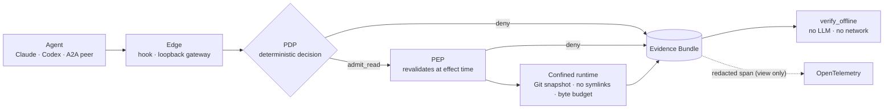

<div align="center">

# ADF

**Agent effect security: a local control plane for coding agents**

**English** · [Português (Brasil)](README.pt-BR.md)

[](https://github.com/Joaolucas2210/agent-effect-security/actions/workflows/quality-gates.yml)


[](LICENSE)

Coding agents read `.env` as easily as `README.md`.<br>
ADF decides every read before it happens, enforces the decision at the moment of the effect,<br>
and leaves evidence that anyone can verify offline, with no LLM and no network.

[Why](#why-adf) · [How it works](#how-it-works) · [Quickstart](#quickstart) · [Coverage](#coverage-and-limits) · [Evidence](#evidence-not-telemetry) · [Docs](#documentation)

</div>

## Why ADF

Claude Code, Codex and remote A2A peers run with the developer's permissions. The tools around them each solve
a different problem, and none of them leaves proof of what was refused.

| | IDE permission prompt | Observability (traces) | **ADF** |
| --- | --- | --- | --- |
| Stops a sensitive read | asks a human, every time | no | **yes, deterministically** |
| Proves what was denied, and why | no | shows what happened | **an Evidence Bundle per decision, verified offline** |
| Same rule across agents | per tool | n/a | **Claude, Codex, A2A, MCP share one PDP and policy** |
| Can read content change the rules? | n/a | n/a | **never: everything read is tagged `cannot_authorize`** |

ADF is deliberately narrow. One effect, `read`, is closed end to end: decision, enforcement, confined runtime,
proof. New effects arrive only with an accepted ADR and recorded design-partner demand.

## How it works



| Layer | Guarantee | Where |
| --- | --- | --- |
| **Edge** | Translates the agent's request into a closed `ToolCallIntent`; never decides, never injects content | [`hooks/`](ai-development-framework/hooks/), [`integration/a2a_gateway.py`](ai-development-framework/integration/a2a_gateway.py) |
| **PDP** | Pure, deterministic admission against a host-pinned policy; default deny with stable reason codes | [`tools/pdp.py`](ai-development-framework/tools/pdp.py) · [ADR 0007](ai-development-framework/docs/architecture-decision-records/0007-runtime-and-tool-policy-boundary.md) |
| **PEP** | Recomputes every binding (run, policy, scope, snapshot, principal) at effect time and consumes the decision once | [`runtime/pep.py`](ai-development-framework/runtime/pep.py) · [ADR 0008](ai-development-framework/docs/architecture-decision-records/0008-pep-and-constrained-local-read-runtime.md) |
| **Runtime** | Reads one regular file by handle from a Git snapshot, with a byte budget and a sensitive-path policy | [`runtime/local_read_runtime.py`](ai-development-framework/runtime/local_read_runtime.py) |
| **Evidence** | One closed, hashed bundle per decision; offline verification and logical replay; never file content | [`integration/local_evidence_bundle.py`](ai-development-framework/integration/local_evidence_bundle.py) · [ADR 0009](ai-development-framework/docs/architecture-decision-records/0009-local-control-plane-evidence-integration.md) |

**Design principles**

- **Default deny.** Missing, extra, non-canonical or unpinned input is a deny with a stable `reason_code`.
- **A decision is not a bearer token.** It is bound to run, policy, profile, scope and intent digest, and revalidated before the file is opened.
- **No LLM in the critical path.** Authorization is code you can test, mutate and replay.
- **Content cannot authorize.** Everything read is tagged `untrusted_workspace_file, cannot_authorize`.
- **Evidence without content.** Bundles hold ids, hashes and reason codes, so they can be shared with an auditor.
- **Humans stay in control.** The host pins policy, maintainers accept ADRs, and a human confirms sensitive effects; agents can only ask.

## Quickstart

```bash
git clone https://github.com/Joaolucas2210/agent-effect-security.git && cd agent-effect-security
python3 -m venv .venv && source .venv/bin/activate
make install-dev            # editable install; creates the `adf` command
make e2e                    # optional: the full fresh-clone release check
```

Protect one of your projects. Nothing outside the opt-in list is touched:

```bash
adf hook-snippet claude                     # paste into ~/.claude/settings.json (fail-safe included)
adf projects enable /abs/path/to/your/repo  # host-side opt-in; nothing is written in its working tree
```

Ask the agent to read two files. This is what it gets back:

```text
Read README.md                → allow   adf: delivered/read_delivered bundle=40d78f59…
Read config/.env              → deny    adf: deny/invalid_scope bundle=99f11384…
cat README.md; cat .env       → deny    adf: unsafe_read_command
```

Then prove it, on any machine, without trusting ADF's own logs:

```bash
adf verify ~/.adf/evidence/<project>/<date>/<session>/99f11384….json
# verified  evidence_bundle  reason_code=invalid_scope
adf projects reasons        # denies, journal-only contract denies, and use per agent
```

## Coverage and limits

| Edge | What is gated | Authentication | Not covered |
| --- | --- | --- | --- |
| Claude Code | `PreToolUse` on `Read` and `Bash` (single `cat PATH`) | host process, plus the subagent identity from the harness | `Grep`, `Glob`, other `Bash` commands, third-party MCP tools |
| Codex CLI | `PreToolUse` on `Bash` with one allowlisted `cat PATH` | host process | `head`, `sed`, `rg`, `python -c`, pipes, redirections |
| A2A peers | `read_workspace_file` over JSON-RPC on `127.0.0.1` | bearer JWT: HS256 (pilot) or RS256 with a pinned JWKS | bearer replay before `exp` (no DPoP or mTLS yet) |
| MCP | `read_snapshot` and the host-side A2A client `read_via_adf` | host process | validated in tests, not yet in a real client |

> [!IMPORTANT]
> ADF is not a sandbox. It reduces what passes through the gated edges and proves every decision there. An agent
> with another route to the disk (`python -c`, an unhooked tool) bypasses it, and the residual is documented, not
> hidden. The full matrix is in [BOUNDARY](docs/product/BOUNDARY.md#support-matrix).

## Identity and least privilege

- **Who asked is part of the decision.** Local subagents become principals such as `claude:security-reviewer`; A2A
  peers are the token's `sub` with a validated, monotonic `act` delegation chain.
- **Per-agent allowlists.** A pinned policy can name principals; anyone it does not name is denied
  (`principal_not_allowlisted`), and a named agent only reads its own paths
  ([ADR 0024](ai-development-framework/docs/architecture-decision-records/0024-principal-rules-in-pinned-policy.md)).
- **Human confirmation bound to the effect.** A flagged skill pauses as `input-required`; only a direct human token
  with `human:confirm` resumes it, and the record carries an `effect_binding` that a swapped path cannot match
  ([ADR 0022](ai-development-framework/docs/architecture-decision-records/0022-a2a-effect-bound-confirmation.md)).
  Confirmation is not authorization: the PDP still decides afterwards.
- **The credential stays outside the model.** The host-side MCP client holds the bearer; the agent only calls `read_via_adf(path)`.

## Evidence, not telemetry

| Signal | Authority | Use |
| --- | --- | --- |
| `EvidenceBundle` and `A2AEvidenceRecord` | **the record** | audit, trial reports, investigations; `adf verify` checks them offline |
| Attempt journal (`_attempts/`) | hash-chained attempts | counts denies that never reached a bundle |
| OpenTelemetry span (`adf.a2a.request`, `adf.local_read.request`) | none | correlate by `bundle_id` / `record_id` in Jaeger or Langfuse; may be missing, never decides |

<details>
<summary><b>See a live A2A trial in Jaeger</b> (real HTTP against the gateway, no mocks)</summary>

<br>

`make a2a-live-trial` replays twelve cases: missing, forged and expired tokens; missing scope; unknown skill;
policy deny; path traversal; root and nested `.env`; an allowed read; and a pause resumed by a human. Every
authenticated request leaves a record that passes `verify_record`, and no span carries a token, `sub`, path or
content. [Full trial reports](ai-development-framework/docs/observability/trials/a2a-live/README.md).


</details>

## Engineering

The quality bar a security control needs, enforced by gates rather than by review comments:

- **Closed contracts.** JSON Schemas with `additionalProperties: false`, each backed by a normative oracle and a negative matrix.
- **Negative tests first.** Every deny path, tampered bundle and forged token has a test, and the gates themselves have tests that must go red.
- **Release proof.** `make e2e` runs the README's path on a fresh clone, and CI runs it on every pull request, alongside full-history secret scanning and SHA-pinned Actions.
- **Honest gates.** A gate that cannot run is reported as skipped, never as passing; unknown measurements stay `na`.
- **Recorded decisions.** Architecture is decided in ADRs (25 at 0.1.0), each with problem, decision, residual risk and rollback.

The repository also contains the agent development harness used to build ADF (skills, commands, evals,
observability). It is optional and outside the security boundary: [install](ai-development-framework/docs/install.md),
[usage](ai-development-framework/docs/USAGE.md).

## Documentation

| I want to… | Read |
| --- | --- |
| Understand what is covered, and what is not | [Boundary and support matrix](docs/product/BOUNDARY.md) |
| Decide whether to pilot it | [One-pager](docs/product/ONEPAGER.md) · [Roadmap](docs/product/ROADMAP.md) · [Pilot report](docs/product/PILOT-20261020.md) |
| Install it on my repositories and run trials | [Trials guide](ai-development-framework/docs/trials.md) |
| Understand the design in depth | [Control plane](ai-development-framework/docs/CONTROL_PLANE.md) · [Architecture](ai-development-framework/docs/ARCHITECTURE.md) · [Glossary](ai-development-framework/docs/GLOSSARY.md) · [ADRs](ai-development-framework/docs/architecture-decision-records/) |
| Run the A2A edge with a real IdP | [RS256 / JWKS runbook](ai-development-framework/docs/runbooks/a2a-rs256-jwks.md) |
| Put the decisions next to the agent's traces | [Langfuse and Jaeger](ai-development-framework/docs/observability/LANGFUSE.md) |

## Contributing, security and license

Contributions are welcome: start with [CONTRIBUTING](CONTRIBUTING.md) and the [Code of Conduct](CODE_OF_CONDUCT.md).
**Report vulnerabilities privately** as described in [SECURITY](SECURITY.md), never in a public issue. Changes are
listed in the [CHANGELOG](CHANGELOG.md), and maintainers release with [docs/RELEASING.md](docs/RELEASING.md).

ADF is released under the [MIT License](LICENSE). Third-party tools used by the development harness
([Graphify](https://github.com/safishamsi/graphify), [RTK](https://github.com/rtk-ai/rtk),
[Ponytail](https://github.com/DietrichGebert/ponytail)) keep their own licenses.
