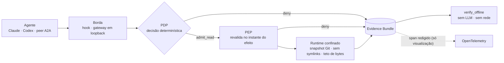

<div align="center">

# ADF

**Segurança de efeitos para agentes: um control plane local para coding agents**

[English](README.md) · **Português (Brasil)**

[](https://github.com/Joaolucas2210/agent-effect-security/actions/workflows/quality-gates.yml)


[](LICENSE)

Coding agents leem `.env` com a mesma facilidade com que leem `README.md`.<br>
O ADF decide cada leitura antes que ela aconteça, aplica a decisão no instante do efeito<br>
e deixa evidência que qualquer pessoa verifica offline, sem LLM e sem rede.

[Por quê](#por-que-o-adf) · [Como funciona](#como-funciona) · [Início rápido](#início-rápido) · [Cobertura](#cobertura-e-limites) · [Evidência](#evidência-não-telemetria) · [Docs](#documentação)

</div>

## Por que o ADF

Claude Code, Codex e peers A2A remotos rodam com as permissões do desenvolvedor. As ferramentas em volta deles
resolvem problemas diferentes, e nenhuma deixa prova do que foi recusado.

| | Prompt de permissão da IDE | Observabilidade (traces) | **ADF** |
| --- | --- | --- | --- |
| Impede uma leitura sensível | pergunta a um humano, toda vez | não | **sim, de forma determinística** |
| Prova o que foi negado, e por quê | não | mostra o que aconteceu | **um Evidence Bundle por decisão, verificado offline** |
| A mesma regra entre agentes | por ferramenta | n/a | **Claude, Codex, A2A e MCP compartilham um PDP e uma policy** |
| O conteúdo lido pode mudar as regras? | n/a | n/a | **nunca: tudo o que é lido é marcado `cannot_authorize`** |

O ADF é estreito de propósito. Um efeito, `read`, está fechado de ponta a ponta: decisão, aplicação, runtime
confinado e prova. Efeitos novos só entram com ADR aceito e demanda registrada de design partner.

## Como funciona



| Camada | Garantia | Onde |
| --- | --- | --- |
| **Borda** | Traduz o pedido do agente num `ToolCallIntent` fechado; nunca decide e nunca injeta conteúdo | [`hooks/`](ai-development-framework/hooks/), [`integration/a2a_gateway.py`](ai-development-framework/integration/a2a_gateway.py) |
| **PDP** | Admissão pura e determinística contra a policy pinada pelo host; default deny com reason codes estáveis | [`tools/pdp.py`](ai-development-framework/tools/pdp.py) · [ADR 0007](ai-development-framework/docs/architecture-decision-records/0007-runtime-and-tool-policy-boundary.md) |
| **PEP** | Recalcula cada vínculo (run, policy, scope, snapshot, principal) no instante do efeito e consome a decisão uma vez | [`runtime/pep.py`](ai-development-framework/runtime/pep.py) · [ADR 0008](ai-development-framework/docs/architecture-decision-records/0008-pep-and-constrained-local-read-runtime.md) |
| **Runtime** | Lê um arquivo regular por handle a partir de um snapshot Git, com teto de bytes e política de paths sensíveis | [`runtime/local_read_runtime.py`](ai-development-framework/runtime/local_read_runtime.py) |
| **Evidência** | Um bundle fechado e com hash por decisão; verificação offline e replay lógico; nunca conteúdo de arquivo | [`integration/local_evidence_bundle.py`](ai-development-framework/integration/local_evidence_bundle.py) · [ADR 0009](ai-development-framework/docs/architecture-decision-records/0009-local-control-plane-evidence-integration.md) |

**Princípios de design**

- **Default deny.** Entrada ausente, extra, não canônica ou sem pin vira deny com um `reason_code` estável.
- **Decisão não é bearer token.** Ela é vinculada a run, policy, perfil, scope e digest do intent, e revalidada antes de o arquivo ser aberto.
- **Nenhum LLM no caminho crítico.** Autorização é código que você testa, muta e reexecuta.
- **Conteúdo não autoriza.** Tudo o que é lido recebe a marca `untrusted_workspace_file, cannot_authorize`.
- **Evidência sem conteúdo.** Bundles guardam ids, hashes e reason codes, então podem ser entregues a um auditor.
- **Humanos no controle.** O host pina a policy, mantenedores aceitam ADRs e um humano confirma efeitos sensíveis; agentes só pedem.

## Início rápido

```bash
git clone https://github.com/Joaolucas2210/agent-effect-security.git && cd agent-effect-security
python3 -m venv .venv && source .venv/bin/activate
make install-dev            # instalação editável; cria o comando `adf`
make e2e                    # opcional: a checagem completa de release em clone novo
```

Proteja um dos seus projetos. Nada fora da lista opt-in é tocado:

```bash
adf hook-snippet claude                     # cole em ~/.claude/settings.json (fail-safe incluído)
adf projects enable /abs/caminho/do/repo    # opt-in no host; nada é escrito no working tree
```

Peça ao agente para ler dois arquivos. É isto que ele recebe de volta:

```text
Read README.md                → allow   adf: delivered/read_delivered bundle=40d78f59…
Read config/.env              → deny    adf: deny/invalid_scope bundle=99f11384…
cat README.md; cat .env       → deny    adf: unsafe_read_command
```

Depois prove, em qualquer máquina, sem confiar nos logs do próprio ADF:

```bash
adf verify ~/.adf/evidence/<projeto>/<data>/<sessao>/99f11384….json
# verified  evidence_bundle  reason_code=invalid_scope
adf projects reasons        # denies, denies de contrato só no journal e uso por agente
```

## Cobertura e limites

| Borda | O que é intermediado | Autenticação | Não coberto |
| --- | --- | --- | --- |
| Claude Code | `PreToolUse` em `Read` e `Bash` (um único `cat PATH`) | processo do host, mais a identidade do subagente vinda do harness | `Grep`, `Glob`, outros comandos `Bash`, tools MCP de terceiros |
| Codex CLI | `PreToolUse` em `Bash` com um único `cat PATH` allowlisted | processo do host | `head`, `sed`, `rg`, `python -c`, pipes, redirecionamentos |
| Peers A2A | `read_workspace_file` via JSON-RPC em `127.0.0.1` | bearer JWT: HS256 (piloto) ou RS256 com JWKS pinada | replay do bearer antes de `exp` (ainda sem DPoP ou mTLS) |
| MCP | `read_snapshot` e o cliente A2A do host `read_via_adf` | processo do host | validado em testes, ainda não num cliente real |

> [!IMPORTANT]
> O ADF não é um sandbox. Ele reduz o que passa pelas bordas intermediadas e prova cada decisão ali. Um agente
> com outra rota até o disco (`python -c`, uma tool sem hook) o contorna, e o residual é documentado, não
> escondido. A matriz completa está na [fronteira](docs/product/BOUNDARY.pt-BR.md#matriz-de-suporte).

## Identidade e menor privilégio

- **Quem pediu faz parte da decisão.** Subagentes locais viram principais como `claude:security-reviewer`; peers
  A2A são o `sub` do token, com uma cadeia de delegação `act` validada e monotônica.
- **Allowlists por agente.** Uma policy pinada pode nomear principais; quem não é nomeado é negado
  (`principal_not_allowlisted`), e um agente nomeado só lê os próprios paths
  ([ADR 0024](ai-development-framework/docs/architecture-decision-records/0024-principal-rules-in-pinned-policy.md)).
- **Confirmação humana ligada ao efeito.** Uma skill marcada pausa como `input-required`; só um token humano direto
  com `human:confirm` a retoma, e o record carrega um `effect_binding` que um path trocado não consegue reproduzir
  ([ADR 0022](ai-development-framework/docs/architecture-decision-records/0022-a2a-effect-bound-confirmation.md)).
  Confirmação não é autorização: o PDP ainda decide depois.
- **A credencial fica fora do modelo.** O cliente MCP do host guarda o bearer; o agente só chama `read_via_adf(path)`.

## Evidência, não telemetria

| Sinal | Autoridade | Uso |
| --- | --- | --- |
| `EvidenceBundle` e `A2AEvidenceRecord` | **o registro** | auditoria, relatórios de trial, investigações; `adf verify` os confere offline |
| Journal de tentativas (`_attempts/`) | tentativas encadeadas por hash | conta os denies que nunca chegaram a um bundle |
| Span OpenTelemetry (`adf.a2a.request`, `adf.local_read.request`) | nenhuma | correlacionar por `bundle_id` / `record_id` no Jaeger ou no Langfuse; pode faltar e nunca decide |

<details>
<summary><b>Veja um trial A2A ao vivo no Jaeger</b> (HTTP real contra o gateway, sem mocks)</summary>

<br>

`make a2a-live-trial` reexecuta doze casos: token ausente, forjado e expirado; scope faltando; skill desconhecida;
deny da policy; path traversal; `.env` na raiz e aninhado; uma leitura permitida; e uma pausa retomada por um
humano. Toda request autenticada deixa um record que passa em `verify_record`, e nenhum span carrega token, `sub`,
path ou conteúdo. [Relatórios completos dos trials](ai-development-framework/docs/observability/trials/a2a-live/README.md).


</details>

## Engenharia

A régua de qualidade que um controle de segurança exige, aplicada por gates e não por comentários de revisão:

- **Contratos fechados.** JSON Schemas com `additionalProperties: false`, cada um sustentado por um oráculo normativo e uma matriz negativa.
- **Testes negativos primeiro.** Cada caminho de deny, bundle adulterado e token forjado tem teste, e os próprios gates têm testes que precisam ficar vermelhos.
- **Prova de release.** `make e2e` executa o caminho deste README num clone novo, e o CI o roda em todo pull request, junto com varredura de segredos no histórico inteiro e Actions fixadas por SHA.
- **Gates honestos.** Gate que não roda é reportado como skipped, nunca como aprovado; medida desconhecida fica `na`.
- **Decisões registradas.** A arquitetura é decidida em ADRs (25 no 0.1.0), cada um com problema, decisão, risco residual e reversão.

O repositório também contém o harness de desenvolvimento de agentes usado para construir o ADF (skills, comandos,
evals, observabilidade). Ele é opcional e fica fora da fronteira de segurança:
[instalação](ai-development-framework/docs/install.md), [uso](ai-development-framework/docs/USAGE.md).

## Documentação

| Eu quero… | Leia |
| --- | --- |
| Entender o que é coberto, e o que não é | [Fronteira e matriz de suporte](docs/product/BOUNDARY.pt-BR.md) |
| Decidir se vale um piloto | [One-pager](docs/product/ONEPAGER.pt-BR.md) · [Roadmap](docs/product/ROADMAP.pt-BR.md) · [Relatório do piloto](docs/product/PILOT-20261020.pt-BR.md) |
| Instalar nos meus repositórios e rodar trials | [Guia de trials](ai-development-framework/docs/trials.pt-BR.md) |
| Entender o design a fundo | [Control plane](ai-development-framework/docs/CONTROL_PLANE.pt-BR.md) · [Arquitetura](ai-development-framework/docs/ARCHITECTURE.pt-BR.md) · [Glossário](ai-development-framework/docs/GLOSSARY.pt-BR.md) · [ADRs](ai-development-framework/docs/architecture-decision-records/) |
| Rodar a borda A2A com um IdP real | [Runbook RS256 / JWKS](ai-development-framework/docs/runbooks/a2a-rs256-jwks.pt-BR.md) |
| Ver as decisões ao lado dos traces do agente | [Langfuse e Jaeger](ai-development-framework/docs/observability/LANGFUSE.pt-BR.md) |

## Contribuição, segurança e licença

Contribuições são bem-vindas: comece pelo [CONTRIBUTING](CONTRIBUTING.pt-BR.md) e pelo [Código de Conduta](CODE_OF_CONDUCT.pt-BR.md).
**Reporte vulnerabilidades em privado**, como descrito no [SECURITY](SECURITY.pt-BR.md), nunca numa issue pública.
As mudanças estão no [CHANGELOG](CHANGELOG.md), e o mantenedor faz releases com o [docs/RELEASING.pt-BR.md](docs/RELEASING.pt-BR.md).

O ADF é distribuído sob a [licença MIT](LICENSE). As ferramentas de terceiros usadas pelo harness de desenvolvimento
([Graphify](https://github.com/safishamsi/graphify), [RTK](https://github.com/rtk-ai/rtk),
[Ponytail](https://github.com/DietrichGebert/ponytail)) mantêm as próprias licenças.
