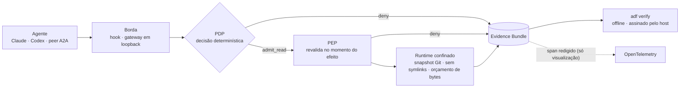
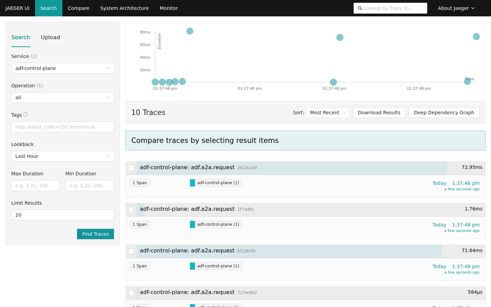

<div align="center">

# ADF

**Agent effect security: um control plane local para agentes de código**

[English](README.md) · **Português (Brasil)**

[](https://github.com/Joaolucas2210/agent-effect-security/actions/workflows/quality-gates.yml)
[](https://github.com/Joaolucas2210/agent-effect-security/releases)


[](LICENSE)

Agentes de código leem `.env` com a mesma facilidade com que leem `README.md`.<br>
O ADF decide cada leitura antes de ela acontecer, aplica a decisão no momento do efeito<br>
e deixa evidência que qualquer um verifica offline — sem LLM, sem rede, sem confiar nos logs do próprio ADF.

**Determinístico · Verificável offline · Menor privilégio · Evidência, não telemetria**

[Por quê](#por-que-o-adf-existe) · [Como funciona](#como-funciona) · [Início rápido](#início-rápido) · [Cobertura](#cobertura-e-limites) · [Evidência](#evidência-não-telemetria) · [Modelo de segurança](#modelo-de-segurança-e-de-ameaças) · [Status](#status-e-roadmap) · [Docs](#documentação)

</div>


<sup>Cada linha acima foi capturada da CLI real e do hook real; [como o GIF é gerado](docs/assets/README.md).</sup>

## Por que o ADF existe

Claude Code, Codex e peers A2A remotos rodam com as permissões do desenvolvedor. As ferramentas ao redor deles
resolvem, cada uma, um problema diferente, e nenhuma deixa prova do que foi recusado.

| Capacidade | Prompt de permissão da IDE | Observabilidade (traces) | **ADF** |
| --- | --- | --- | --- |
| Bloqueia uma leitura sensível | pergunta a um humano, toda vez | não | **sim, deterministicamente** |
| Prova o que foi negado, e por quê | não | mostra o que aconteceu | **um Evidence Bundle por decisão, verificado offline** |
| Mesma policy entre agentes | por ferramenta | n/a | **Claude, Codex, A2A e MCP compartilham um PDP e uma policy** |
| O conteúdo lido pode mudar as regras? | n/a | n/a | **nunca: tudo que é lido recebe `cannot_authorize`** |
| O agente pode editar as regras sob as quais roda? | sim (`settings.json`) | n/a | **escritas em config de agente/IDE são negadas; os arquivos do próprio ADF são pinados** |

O ADF é deliberadamente estreito. Um efeito, `read`, está fechado de ponta a ponta: decisão, enforcement, runtime
confinado, prova. Todo o resto que ele toca é **deny-only**: pode recusar, nunca admite. Efeitos novos só entram com
uma ADR aceita e demanda de design partner registrada.

## Como funciona



| Camada | Garantia | Onde |
| --- | --- | --- |
| **Borda** | Traduz o pedido do agente em um `ToolCallIntent` fechado; nunca decide, nunca injeta conteúdo. Os gates deny-only para as tools que o ADF não media ficam aqui | [`hooks/`](ai-development-framework/hooks/), [`integration/a2a_gateway.py`](ai-development-framework/integration/a2a_gateway.py) |
| **PDP** | Admissão pura e determinística contra uma policy pinada pelo host; default deny com reason codes estáveis; sem relógio, sem I/O, sem LLM | [`tools/pdp.py`](ai-development-framework/tools/pdp.py) · [ADR 0007](ai-development-framework/docs/architecture-decision-records/0007-runtime-and-tool-policy-boundary.md) |
| **PEP** | Recomputa cada binding (run, policy, scope, snapshot, principal) no momento do efeito e consome a decisão uma vez | [`runtime/pep.py`](ai-development-framework/runtime/pep.py) · [ADR 0008](ai-development-framework/docs/architecture-decision-records/0008-pep-and-constrained-local-read-runtime.md) |
| **Runtime** | Lê um arquivo regular por handle a partir de um snapshot Git, com orçamento de bytes e uma policy de paths sensíveis versionada | [`runtime/local_read_runtime.py`](ai-development-framework/runtime/local_read_runtime.py) |
| **Evidência** | Um bundle fechado, com hash e assinado pelo host por decisão; verificação offline e replay lógico; nunca o conteúdo do arquivo | [`integration/local_evidence_bundle.py`](ai-development-framework/integration/local_evidence_bundle.py) · [ADR 0009](ai-development-framework/docs/architecture-decision-records/0009-local-control-plane-evidence-integration.md) |

## Início rápido

Funciona em clone fresco; `make e2e` roda exatamente este caminho no CI a cada pull request.

```bash
git clone https://github.com/Joaolucas2210/agent-effect-security.git && cd agent-effect-security
python3 -m venv .venv && source .venv/bin/activate
make install-dev                 # instalação editável; cria o comando `adf`

adf key init                     # chave do host: todo bundle ganha assinatura (imprime a linha de export)
adf hook-snippet claude          # cole em ~/.claude/settings.json; o export da chave já vai junto
adf projects enable /caminho/abs/do/seu/repo   # opt-in do lado do host; nada é escrito na árvore do repo
adf doctor --pin                 # pina o código do ADF, as policies e o registro do hook contra adulteração
```

Peça ao agente para ler dois arquivos. É isto que ele recebe de volta:

```text
Read README.md                → allow   adf: delivered/read_delivered bundle=0f5cf8fc…
Read .env                     → deny    adf: deny/invalid_scope bundle=85267e0e…
Edit .claude/settings.json    → deny    adf: uncovered_write_denied_agent_config
head config/.env              → deny    adf: uncovered_read_denied_sensitive
WebFetch https://…  (depois disso) deny  adf: uncovered_network_denied_after_sensitive_read
```

Depois prove, em qualquer máquina, sem confiar nos logs do próprio ADF:

```bash
adf verify ~/.adf/evidence/<projeto>/<data>/<sessão>/85267e0e….json --key ~/.adf/evidence.key
# verified  evidence_bundle  reason_code=invalid_scope  authenticity=valid  delivery_mode=gate_only
adf projects reasons             # denies, tentativas só no journal, delivery mode e uso por agente
adf doctor                       # control plane intact | control_plane_tampered: <labels>
```

O Codex CLI usa a mesma lista do host via `adf hook-snippet codex`. Instalação completa, protocolo de trials e o
policy pack por projeto estão no [guia de trials](ai-development-framework/docs/trials.md).

## Cobertura e limites

O que está gated hoje, em `main`. Tudo fora desta tabela é **residual**: o ADF não vê nem bloqueia.

| Borda | Admitido com bundle | Negado (deny-only, no journal) | Não coberto |
| --- | --- | --- | --- |
| **Claude Code** | `Read` (gate: a tool nativa entrega os bytes); `Bash` com um único `cat PATH` | `Grep`/`Glob` em paths sensíveis; `Edit`/`Write`/`MultiEdit`/`NotebookEdit` em paths sensíveis e de config de agente (`.claude/`, `.codex/`, `.cursor/`, `.mcp.json`, `.vscode/settings.json`, `.github/workflows/`, `CLAUDE.md`…); equivalentes de leitura em Bash (`head`, `tail`, `sed`, `grep`, `rg`, `awk`, …) em paths sensíveis e qualquer forma que a gramática não enxerga; `WebFetch` e `curl`/`wget` após uma tentativa sensível na mesma sessão; chamadas `mcp__*` fora do registry do host ou cuja definição de server mudou | `Grep`/`Glob` sem `path`; `bash script.sh`; binários de leitura fora da gramática; interpretadores que leem sem `open(`; tools de subagente fora desta lista |
| **Codex CLI** | `Bash` com um único `cat PATH` | a mesma gramática Bash e a mesma regra de rede | chamadas MCP (o Codex não as envia aos hooks); `WebFetch` |
| **Peers A2A** | `read_workspace_file` por JSON-RPC em `127.0.0.1`, bearer JWT (HS256 piloto ou RS256 com JWKS pinado), cadeia de delegação `act`, confirmação humana amarrada ao efeito | — | replay do bearer antes do `exp` (sem DPoP ou mTLS ainda); TLS só via proxy no host |
| **MCP** | tool stdio `read_snapshot` (o ADF entrega os bytes: `delivery_mode=mediated`); client A2A do lado do host `read_via_adf` | servers/tools fora do registry pinado; server cujo `command`/`args`/chaves de env mudaram em qualquer escopo de config do Claude Code; tools declaradas pelo host como write/network após uma tentativa sensível | rug-pull da lista de tools entre execuções de `adf mcp probe`; servers iniciados fora do hook; o output do próprio server (tainted, não bloqueado) |

> [!IMPORTANT]
> O ADF não é um sandbox. Ele reduz o que passa pelas bordas gated e prova cada decisão ali. Um agente com outra
> rota para o disco passa por fora, e o residual é documentado, não escondido. A matriz oficial está em
> [BOUNDARY](docs/product/BOUNDARY.pt-BR.md#matriz-de-suporte); doze incidentes reais mapeados para
> `covered | residual | out_of_scope` estão no [mapa de cobertura](docs/knowledge/coverage.md).

**Identidade e menor privilégio.** Subagentes locais são principals (`claude:security-reviewer`, agindo por `claude:main`);
peers A2A são o `sub` do token com uma cadeia `act` validada. Uma policy pinada pode nomear principals, dar a cada um os
próprios paths e limitar a profundidade em que um principal pode agir; quem ela não nomeia é negado
([ADR 0024](ai-development-framework/docs/architecture-decision-records/0024-principal-rules-in-pinned-policy.md),
[ADR 0033](ai-development-framework/docs/architecture-decision-records/0033-subagent-principal-propagation.md)).
Uma skill A2A marcada pausa em `input-required`; só um token humano direto a retoma, e o record carrega um
`effect_binding` que um path trocado não consegue bater ([ADR 0022](ai-development-framework/docs/architecture-decision-records/0022-a2a-effect-bound-confirmation.md)).
Confirmação não é autorização: o PDP ainda decide depois. O bearer fica fora do modelo: o agente só chama `read_via_adf(path)`.

## Evidência, não telemetria

| Sinal | Autoridade | O que prova |
| --- | --- | --- |
| `EvidenceBundle` (um por decisão) e `A2AEvidenceRecord` | **o registro** | decisão, bindings, digest do snapshot, receipt; `delivery_mode` diz se o ADF entregou os bytes (`mediated`) ou só decidiu (`gate_only`); uma assinatura HMAC destacada, com chave do host, diz que o ADF o emitiu |
| Journal de tentativas (`_attempts/`, encadeado por hash) | o registro para denies que nunca chegaram ao adapter | toda decisão deny-only, deny de tamper e deny de contrato, com principal e profundidade, nunca um path |
| Spans OpenTelemetry (`adf.local_read.request`, `adf.a2a.request`) | nenhuma | correlacionar por `bundle_id`/`record_id` no Jaeger ou Langfuse; podem faltar, não carregam path, comando, URL ou conteúdo, nunca decidem |

`adf verify ARQUIVO --key ~/.adf/evidence.key` confere schema, canonicalização, digests, receipt e bindings offline e
depois a assinatura: `authenticity=valid | invalid | unsigned | not_checked`. Um bundle nunca contém conteúdo de arquivo,
path físico, argumentos brutos ou segredo, então pode ser entregue a um auditor. Um bundle nunca é entrada de
autorização (`is_authorization()` é sempre `False`).

<details>
<summary><b>Veja um trial A2A ao vivo no Jaeger</b> (HTTP real contra o gateway, sem mocks)</summary>

<br>

`make a2a-live-trial` repete doze casos: tokens ausente, forjado e expirado; scope ausente; skill desconhecida;
deny de policy; path traversal; `.env` na raiz e aninhado; uma leitura permitida; e uma pausa retomada por um humano.
Toda request autenticada deixa um record que passa em `verify_record`, e nenhum span carrega token, `sub`, path ou
conteúdo. [Relatórios completos](ai-development-framework/docs/observability/trials/a2a-live/README.md).



</details>

## Modelo de segurança e de ameaças

O atacante é **conteúdo não confiável que chega ao agente** — arquivos do workspace (arquivos de instrução e de
configuração incluídos), output e descrições de tools MCP, mensagens A2A, dependências, páginas web — e ele pode fazer o
modelo pedir qualquer tool call, `Bash` incluído. O operador do host, o código instalado do ADF e o snapshot Git são
confiáveis; o checkout vivo, os payloads das tools, a saída do modelo e tudo que é lido não são. Seis claims são
permitidas em texto público, cada uma amarrada a um mecanismo e a um teste; "previne prompt injection", "sandbox" e
"cobre Bash" são proibidas. Modelo completo, claims C1–C6, Lethal Trifecta e mapeamento OWASP Agentic 2026:
[ADR 0026](ai-development-framework/docs/architecture-decision-records/0026-threat-model-and-claims.md) · boundary do
produto: [BOUNDARY](docs/product/BOUNDARY.pt-BR.md).

Princípios inegociáveis:

- **Default deny.** Entrada ausente, extra, não canônica ou não pinada é deny com `reason_code` estável.
- **Decisão não é bearer token.** Amarrada a run, policy, profile, scope e digest do intent; revalidada antes de abrir o arquivo; consumida uma vez.
- **Sem LLM no caminho crítico.** Autorização é código que você testa, muta e repete.
- **Conteúdo não autoriza.** Tudo que é lido recebe `untrusted_workspace_file, cannot_authorize`; descrições de tools não autorizam nada.
- **Evidência sem conteúdo.** Bundles guardam ids, hashes e reason codes; uma chave do host os assina.
- **O control plane vigia a si mesmo.** `adf doctor --pin` registra o código do ADF, as policies do runtime, a lista de projetos e o registro do hook; qualquer divergência nega toda chamada gated com `control_plane_tampered` até um humano re-pinar ([ADR 0027](ai-development-framework/docs/architecture-decision-records/0027-control-plane-self-integrity.md)).
- **Humanos no controle.** O host pina policy, chaves e o registry MCP; mantenedores aceitam ADRs; um humano confirma efeitos sensíveis. Agentes só podem pedir.

## Desenvolvimento e barra de engenharia

A barra de qualidade que um controle de segurança precisa, imposta por gates e não por comentários de review:

- **Contratos fechados.** JSON Schemas com `additionalProperties: false`, cada um com oráculo normativo e matriz negativa.
- **Testes negativos primeiro.** Todo caminho de deny, bundle adulterado, assinatura forjada, definição alterada e token forjado tem teste; comportamento novo nasce com um self-test que rodou vermelho antes do código.
- **Prova de release.** `make e2e` roda o Início rápido num clone fresco, e o CI roda isso a cada pull request, junto com `make quality-check`, varredura de segredos no histórico inteiro, CodeQL e Actions pinadas por SHA.
- **Gates honestos.** Um gate que não consegue rodar é reportado como skipped, nunca como aprovado; medidas desconhecidas ficam `na`.
- **Decisões registradas.** A arquitetura é decidida em [ADRs](ai-development-framework/docs/architecture-decision-records/) (36 até aqui), cada uma com problema, opções, risco residual e rollback; mudança de efeito ou de boundary cita uma ameaça da [base de conhecimento](docs/knowledge/README.md).

```bash
make quality-check   # self-tests, contratos, complexidade, evals — sem gravar evidência
make e2e             # clone fresco, venv novo, as duas bordas, os dois trials
```

O repositório também contém o harness de desenvolvimento com agentes usado para construir o ADF (skills, comandos,
evals, observabilidade). É opcional e fica fora do boundary de segurança: [instalação](ai-development-framework/docs/install.md),
[uso](ai-development-framework/docs/USAGE.md).

## Status e roadmap

**Experimental, 0.x.** As ADRs 0001–0036 estão `Accepted` e implementadas, com uma exceção:

| Área | Estado |
| --- | --- |
| Efeito `read`: PDP → PEP → runtime confinado → bundle assinado | entregue (ADRs 0007–0012, 0029, 0030, 0036) |
| Gates deny-only: paths, config de agente, gramática Bash, rede após tentativa sensível | entregue (ADR 0028) |
| Registry MCP: nomes, definições de server, probe offline da lista de tools, efeitos declarados | entregue (ADR 0031) |
| Integridade do próprio control plane | entregue (ADR 0027) |
| Identidade: principals de subagente e A2A, paths e profundidade por principal | entregue (ADRs 0023, 0024, 0033) |
| Efeito `write` | **Proposta e bloqueada** até uma demanda de design partner ser registrada (ADR 0032) |
| Piloto no host do mantenedor | em curso até 2026-11-11 ([achados](docs/product/PILOT-20261104.pt-BR.md)) |

Deliberadamente fora de escopo: sandbox de SO, cobertura total de `Bash`, efeitos `network` ou `destructive`, um
guardião LLM no lugar do PDP, SaaS, SSO, dashboards, billing, telemetria ligada por padrão.
[Roadmap](docs/product/ROADMAP.pt-BR.md) · [Changelog](CHANGELOG.md).

## Documentação

| Quero… | Leia |
| --- | --- |
| Entender o que é coberto, e o que não é | [Boundary e matriz de suporte](docs/product/BOUNDARY.pt-BR.md) · [Mapa de cobertura de incidentes reais](docs/knowledge/coverage.md) |
| Decidir se faço um piloto | [One-pager](docs/product/ONEPAGER.pt-BR.md) · [Roadmap](docs/product/ROADMAP.pt-BR.md) · Pilotos: [2026-10-20](docs/product/PILOT-20261020.pt-BR.md), [2026-11-04](docs/product/PILOT-20261104.pt-BR.md) |
| Instalar nos meus repositórios e rodar trials | [Guia de trials](ai-development-framework/docs/trials.pt-BR.md) |
| Entender o design a fundo | [Control plane](ai-development-framework/docs/CONTROL_PLANE.pt-BR.md) · [Arquitetura](ai-development-framework/docs/ARCHITECTURE.pt-BR.md) · [Glossário](ai-development-framework/docs/GLOSSARY.pt-BR.md) · [ADRs](ai-development-framework/docs/architecture-decision-records/) |
| Saber quais ameaças e papers moldaram o design | [Base de conhecimento](docs/knowledge/README.md) |
| Rodar a borda A2A com um IdP real | [Runbook RS256 / JWKS](ai-development-framework/docs/runbooks/a2a-rs256-jwks.md) |
| Colocar as decisões ao lado dos traces do agente | [Langfuse e Jaeger](ai-development-framework/docs/observability/LANGFUSE.pt-BR.md) |

## Licença e contribuição

Contribuições são bem-vindas: comece por [CONTRIBUTING](CONTRIBUTING.pt-BR.md) e pelo [Código de Conduta](CODE_OF_CONDUCT.pt-BR.md).
**Reporte vulnerabilidades em privado** como descrito em [SECURITY](SECURITY.pt-BR.md), nunca em issue pública. As mudanças
estão no [CHANGELOG](CHANGELOG.md), e os mantenedores lançam versões com [docs/RELEASING.pt-BR.md](docs/RELEASING.pt-BR.md).

O ADF é distribuído sob a [Licença MIT](LICENSE). Ferramentas de terceiros usadas pelo harness de desenvolvimento
([Graphify](https://github.com/safishamsi/graphify), [RTK](https://github.com/rtk-ai/rtk),
[Ponytail](https://github.com/DietrichGebert/ponytail)) mantêm as próprias licenças.
