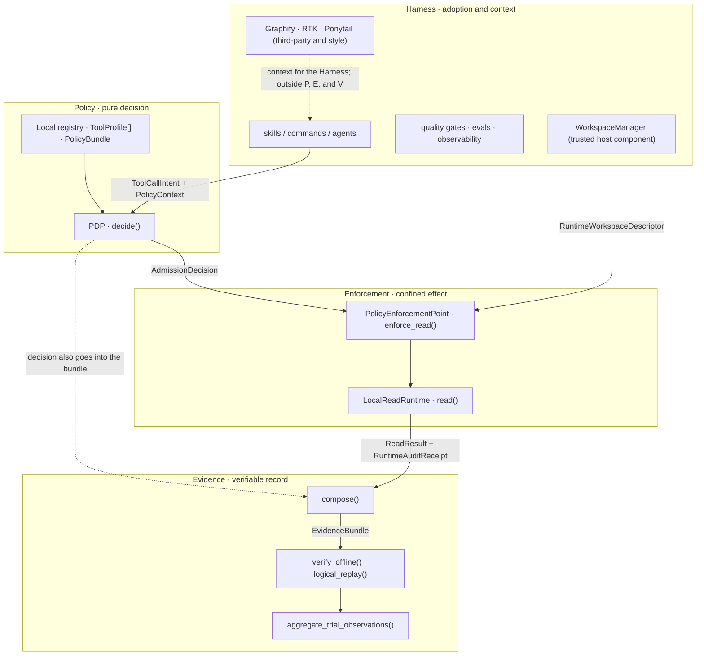
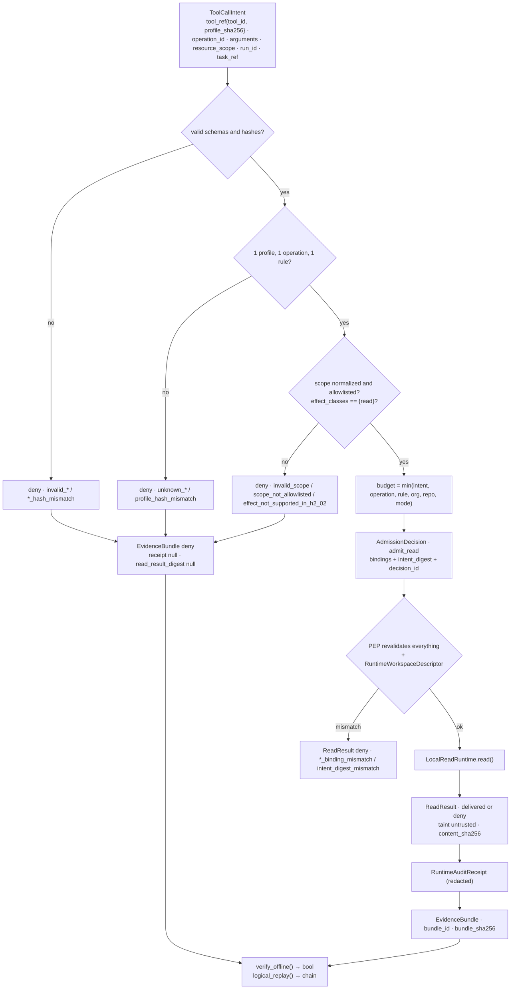
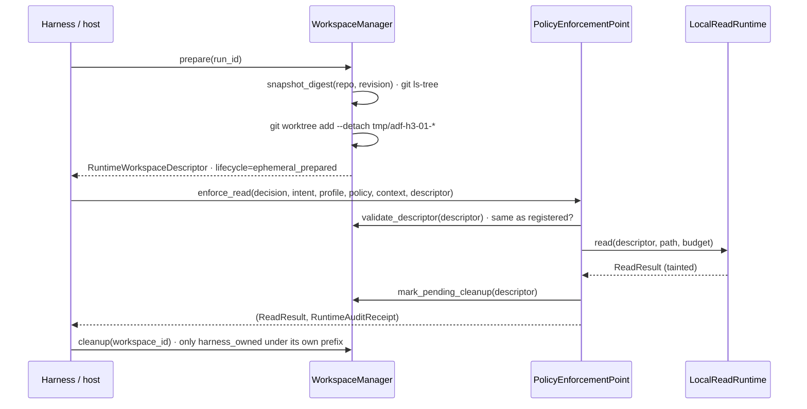
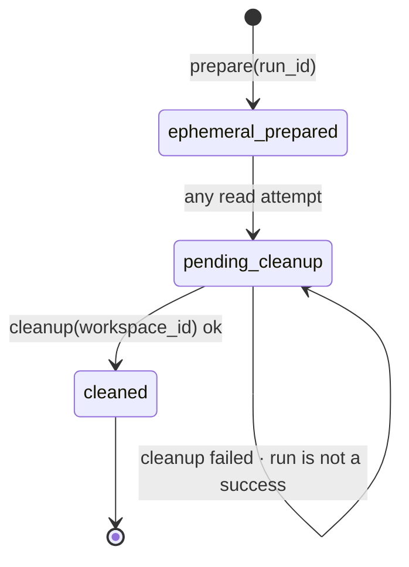
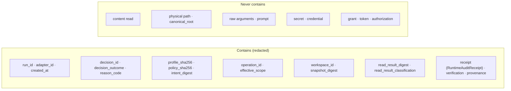

# Architecture

**English** · [Português (Brasil)](ARCHITECTURE.pt-BR.md)

Date: 2026-09-23 · Aligned with `main` · Type and function names are the ones used in the code and the ADRs.

## 1. Two layers, one monorepo

```text
agent-effect-security/
├── README.md, Makefile, setup-adf.sh, AGENTS.md     entrypoints
├── docs/specs/                                      approved H0–H7 Spec
├── .claude/ .codex/ .cursor/                        symlinks → core (platform adapters)
└── ai-development-framework/                        CORE (single source of truth)
    ├── contracts/v1/     H1-02 · 7 run contracts (TaskSpec, RunConfig, ToolCapability, RunEvent, GateResult, EvalResult, ContextItem)
    ├── modes/            H2-01 · resolver.py + mode catalog (Mode → RunConfig)
    ├── tools/            H2-02 · pdp.py + v1/{schemas,examples,tests}
    ├── runtime/          H3-01 · pep.py, local_read_runtime.py, workspace_manager.py, contracts.py + v1/
    ├── integration/      H4-01 · local_evidence_bundle.py, evidence_trial_metrics.py + v1/
    ├── hooks/            gates, evals, observability, self-tests (test-*.sh/.py), pilot
    ├── skills/ commands/ agents/ rules/ loops       Harness
    ├── mcp/servers.json  static inventory (empty); not an executor
    └── docs/             ADRs, this document, evals, metrics, observability
```

## 2. Separation of responsibilities



| Layer | Can | Cannot |
| --- | --- | --- |
| Registry + PDP | validate schemas and hashes, intersect allowlists, emit a canonical decision | open a file, process, socket, MCP, Git; query an LLM; grant approval |
| PEP | revalidate bindings, consume a decision, call the runtime once, emit a receipt | reuse a decision, accept `deny`/`approval_required`, accept a root/cwd from the agent |
| LocalReadRuntime | open by handle, `fstat`, read up to `max_output_bytes`, deny a sensitive path | follow a symlink, read a directory/FIFO/device/socket, write, network |
| WorkspaceManager | `git worktree add --detach` / `remove` / `prune` on the host's repo and revision | be called by the agent, accept an arbitrary path, remove outside its own prefix |
| Evidence | compose, hash, verify, logical replay, aggregate | re-execute a read, authorize (`is_authorization` is always `False`) |
| Harness | build intents, prepare the workspace, consume a tainted `ReadResult`, run gates | enforcement of any kind |

## 3. Admission and evidence flow



All output is canonical JSON (sorted keys, compact separators, UTF-8). `decision_id`,
`receipt_id`, `bundle_id`, and `report_sha256` are the SHA-256 of the object itself without the ID field.

## 4. Workspace lifecycle

The agent never creates a worktree. The host prepares it, the PEP consumes it, the host cleans it up.





Only `ephemeral_prepared` produces a read. The intent's `task_ref` and the descriptor's `snapshot_digest`
must be identical, otherwise `task_ref_mismatch`. A descriptor that is unregistered, altered, or has a
nonexistent root produces `workspace_binding_mismatch`.

## 5. Evidence Bundle: what it contains and what it forbids



| Field | Source | Verified by `verify_offline` |
| --- | --- | --- |
| `bundle_id` | SHA-256 of the bundle without `bundle_id` and without `bundle_sha256` | recomputed |
| `verification.bundle_sha256` | SHA-256 of the bundle without `bundle_sha256` | recomputed |
| `receipt.receipt_id` | SHA-256 of the receipt without `receipt_id` | recomputed |
| `read_result_digest` | SHA-256 of the redacted projection of the `ReadResult` (includes taint and `content_sha256`, never content) | recomputed from the receipt |
| bindings | equal between bundle and receipt (`decision_id`, `run_id`, `operation_id`, `effective_scope`, hashes, `workspace_id`, `snapshot_digest`) | compared |
| `decision_outcome != admit_read` | | requires `receipt`, `read_result_digest`, and `read_result_classification` to be null |

## 6. Stable reason codes

| Origin | Codes |
| --- | --- |
| PDP (`tools/pdp.py`) | `admit_read`, `pdp_configuration_error`, `invalid_intent`, `invalid_registry`, `invalid_policy`, `invalid_policy_context`, `unknown_profile`, `unknown_tool`, `profile_hash_mismatch`, `unknown_operation`, `sensitive_argument_rejected`, `invalid_arguments`, `invalid_scope`, `policy_hash_mismatch`, `unknown_policy`, `policy_binding_mismatch`, `run_binding_mismatch`, `unknown_policy_rule`, `effect_not_supported_in_h2_02`, `runtime_capability_not_demonstrated`, `effect_not_allowlisted`, `scope_not_allowlisted`, `budget_exceeds_ceiling` |
| PEP (`runtime/pep.py`) | `invalid_contract`, `invalid_admission`, `binding_mismatch`, `scope_binding_mismatch`, `intent_digest_mismatch`, `profile_hash_mismatch`, `policy_hash_mismatch`, `run_binding_mismatch`, `runtime_capability_mismatch`, `operation_binding_mismatch`, `policy_binding_mismatch`, `budget_binding_mismatch`, `task_ref_mismatch`, `workspace_binding_mismatch` |
| Runtime (`runtime/local_read_runtime.py`) | `read_delivered`, `safe_open_unavailable`, `invalid_path`, `sensitive_path_denied`, `unsafe_file_type`, `output_limit_exceeded`, `content_encoding_invalid`, `safe_open_failed` |
| WorkspaceManager | `workspace_git_unavailable`, `workspace_repository_invalid`, `workspace_revision_unavailable`, `workspace_snapshot_enumeration_failed`, `workspace_worktree_prepare_failed`, `workspace_worktree_cleanup_failed`, `workspace_worktree_prune_failed`, `workspace_configuration_invalid`, `workspace_run_id_invalid` |

## 7. Trust boundaries

```text
syntactic scope normalization .......... PDP (H2-02)
physical resolution and enforcement .... PEP + LocalReadRuntime (H3-01)
strong process/host isolation .......... does not exist (H3-02, blocked)
```

- Agent input: `ToolCallIntent` and `arguments`. Everything else (profiles, policy, context,
  descriptor) comes from the host and is validated by a closed schema and a hash.
- Output to the agent: `ReadResult` with `taint.cannot_authorize = true`. The Harness is responsible
  for not letting that content change instructions.
- Secrets: an argument whose name matches `secret|password|credential|api[_-]?key|token` is
  rejected before any digest (`sensitive_argument_rejected`).
- Audit: the receipt stores IDs, hashes, `bytes_read`, `reason_code`, timestamp; never content
  or a physical path.

## 8. How the architecture is tested

- **Normative oracles** in `*/v1/tests/normative-oracles.json`: a human transcription of the ADRs;
  the test fails if schema and oracle diverge. Never generated from the schema.
- **Declared negative matrix**: each `test-*.py` prints `matrix declared / executed / missing /
  skipped / failed`. `missing > 0` or `failed > 0` fails. `skipped` stays visible (for example,
  a socket or device fixture on platforms that do not allow them).
- **Non-import proof**: tests check that `tools/pdp.py`, `runtime/pep.py`, and
  `runtime/local_read_runtime.py` do not import `subprocess`, `socket`, HTTP, MCP, or Git.
- **Pinned validator**: the exact `jsonschema` version in `requirements-test.txt` (checked by `hooks/require_pins.py`). Any other version fails; there is no false green.
- **Pilot**: `make local-evidence-pilot` runs three trials (admit, deny, sensitive path) on
  internal revisions and verifies the aggregated report before printing it.

Commands: `make test-all`, `make quality-check`, `bash hooks/test-tool-admission.sh`,
`bash hooks/test-runtime-read.sh`, `bash hooks/test-local-evidence-bundle.sh`,
`bash hooks/test-evidence-trial-metrics.sh`, `bash hooks/test-local-evidence-pilot.sh`.

## 9. Harness (summary)

Adoption and context layer. Skills and commands (`/spec` → `/plan` → `/build` → `/test` →
`/review` → `/ship`), five archetypes as documentation modes (`loops/`), quality gates per
detected stack, Evaluation-Driven Development (`make eval`), JSONL observability with
trajectories, a suggest-only learning loop (`make learn`), maintenance routines in `DRY_RUN=1`.
Graphify and RTK are third-party tools; Ponytail is a style skill. Details in
[USAGE.md](USAGE.md), [install.md](install.md), and [github-native-pipeline.md](github-native-pipeline.md).

The point of contact between the Harness and the control plane is the **adapter** (H4-01 `AdapterRequest`): it
composes intent, profiles, policy, context, and descriptor; it does not decide, execute, or authorize.
