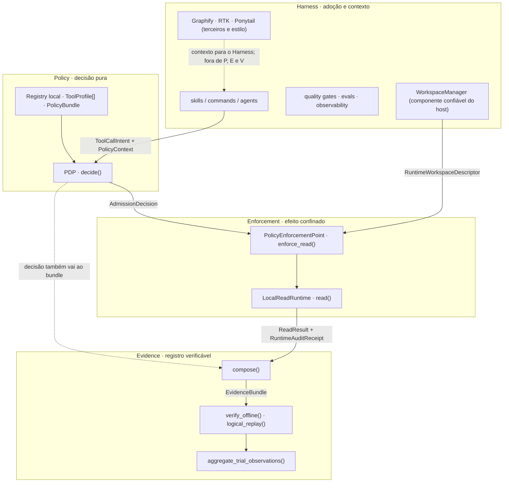
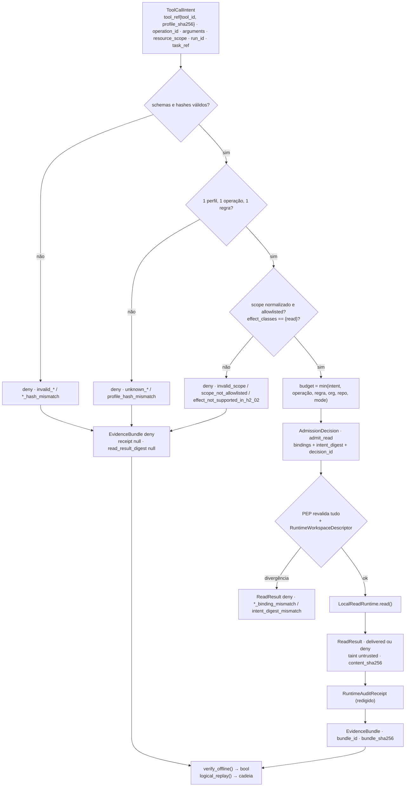
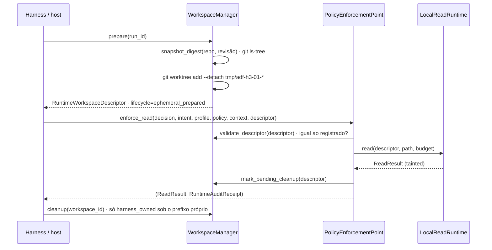
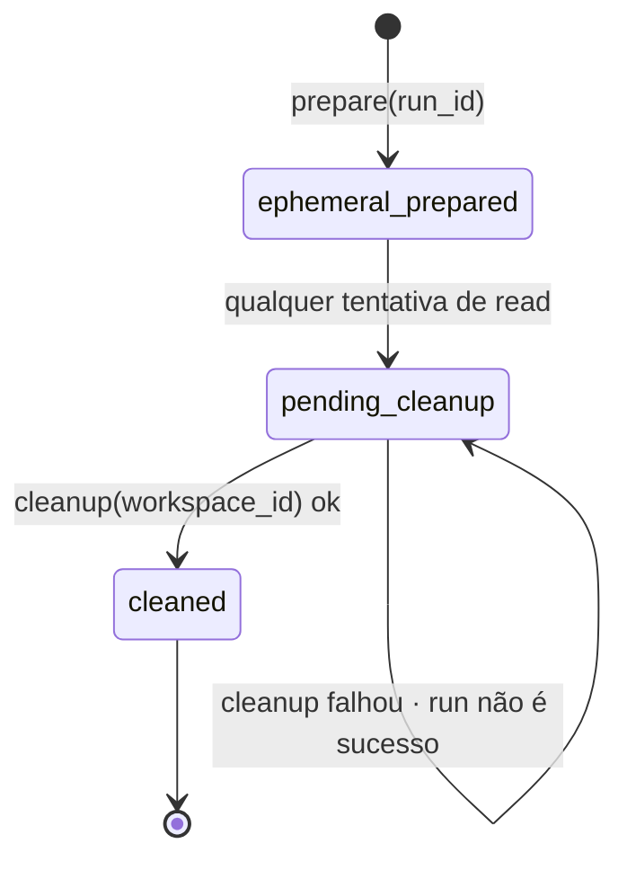
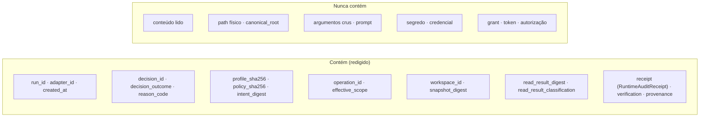

# Arquitetura

[English](ARCHITECTURE.md) · **Português (Brasil)**

Data: 2026-09-23 · Alinhado a `main` · Nomes de tipos e funções são os do código e dos ADRs.

## 1. Duas camadas, um monorepo

```text
agent-effect-security/
├── README.md, Makefile, setup-adf.sh, AGENTS.md     entrypoints
├── docs/specs/                                      Spec H0–H7 aprovada
├── .claude/ .codex/ .cursor/                        symlinks → core (adapters de plataforma)
└── ai-development-framework/                        CORE (única fonte de verdade)
    ├── contracts/v1/     H1-02 · 7 contratos de run (TaskSpec, RunConfig, ToolCapability, RunEvent, GateResult, EvalResult, ContextItem)
    ├── modes/            H2-01 · resolver.py + catálogo de modos (Mode → RunConfig)
    ├── tools/            H2-02 · pdp.py + v1/{schemas,examples,tests}
    ├── runtime/          H3-01 · pep.py, local_read_runtime.py, workspace_manager.py, contracts.py + v1/
    ├── integration/      H4-01 · local_evidence_bundle.py, evidence_trial_metrics.py + v1/
    ├── hooks/            gates, evals, observabilidade, self-tests (test-*.sh/.py), pilot
    ├── skills/ commands/ agents/ rules/ loops       Harness
    ├── mcp/servers.json  inventário estático (vazio); não é executor
    └── docs/             ADRs, este documento, evals, métricas, observabilidade
```

## 2. Separação de responsabilidades



| Camada | Pode | Não pode |
| --- | --- | --- |
| Registry + PDP | validar schemas e hashes, intersectar allowlists, emitir decisão canônica | abrir arquivo, processo, socket, MCP, Git; consultar LLM; conceder aprovação |
| PEP | revalidar bindings, consumir uma decisão, chamar o runtime uma vez, emitir receipt | reutilizar decisão, aceitar `deny`/`approval_required`, aceitar root/cwd do agente |
| LocalReadRuntime | abrir por handle, `fstat`, ler até `max_output_bytes`, negar path sensível | seguir symlink, ler diretório/FIFO/device/socket, escrever, rede |
| WorkspaceManager | `git worktree add --detach` / `remove` / `prune` sobre repo e revisão do host | ser chamado pelo agente, aceitar path arbitrário, remover fora do seu prefixo |
| Evidence | compor, hashear, verificar, replay lógico, agregar | reexecutar leitura, autorizar (`is_authorization` é sempre `False`) |
| Harness | montar intents, preparar workspace, consumir `ReadResult` tainted, rodar gates | enforcement de qualquer tipo |

## 3. Fluxo de admissão e evidência



Toda saída é JSON canônico (chaves ordenadas, separadores compactos, UTF-8). `decision_id`,
`receipt_id`, `bundle_id` e `report_sha256` são SHA-256 do próprio objeto sem o campo de ID.

## 4. Lifecycle do workspace

O agente nunca cria worktree. O host prepara, o PEP consome, o host limpa.





Só `ephemeral_prepared` produz leitura. `task_ref` do intent e `snapshot_digest` do descriptor
devem ser idênticos, senão `task_ref_mismatch`. Descriptor não registrado, alterado ou com root
inexistente produz `workspace_binding_mismatch`.

## 5. Evidence Bundle: o que contém e o que proíbe



| Campo | Fonte | Verificado por `verify_offline` |
| --- | --- | --- |
| `bundle_id` | SHA-256 do bundle sem `bundle_id` e sem `bundle_sha256` | recomputado |
| `verification.bundle_sha256` | SHA-256 do bundle sem `bundle_sha256` | recomputado |
| `receipt.receipt_id` | SHA-256 do receipt sem `receipt_id` | recomputado |
| `read_result_digest` | SHA-256 da projeção redigida do `ReadResult` (inclui taint e `content_sha256`, nunca conteúdo) | recomputado a partir do receipt |
| bindings | iguais entre bundle e receipt (`decision_id`, `run_id`, `operation_id`, `effective_scope`, hashes, `workspace_id`, `snapshot_digest`) | comparados |
| `decision_outcome != admit_read` | | exige `receipt`, `read_result_digest` e `read_result_classification` nulos |

## 6. Reason codes estáveis

| Origem | Códigos |
| --- | --- |
| PDP (`tools/pdp.py`) | `admit_read`, `pdp_configuration_error`, `invalid_intent`, `invalid_registry`, `invalid_policy`, `invalid_policy_context`, `unknown_profile`, `unknown_tool`, `profile_hash_mismatch`, `unknown_operation`, `sensitive_argument_rejected`, `invalid_arguments`, `invalid_scope`, `policy_hash_mismatch`, `unknown_policy`, `policy_binding_mismatch`, `run_binding_mismatch`, `unknown_policy_rule`, `effect_not_supported_in_h2_02`, `runtime_capability_not_demonstrated`, `effect_not_allowlisted`, `scope_not_allowlisted`, `budget_exceeds_ceiling` |
| PEP (`runtime/pep.py`) | `invalid_contract`, `invalid_admission`, `binding_mismatch`, `scope_binding_mismatch`, `intent_digest_mismatch`, `profile_hash_mismatch`, `policy_hash_mismatch`, `run_binding_mismatch`, `runtime_capability_mismatch`, `operation_binding_mismatch`, `policy_binding_mismatch`, `budget_binding_mismatch`, `task_ref_mismatch`, `workspace_binding_mismatch` |
| Runtime (`runtime/local_read_runtime.py`) | `read_delivered`, `safe_open_unavailable`, `invalid_path`, `sensitive_path_denied`, `unsafe_file_type`, `output_limit_exceeded`, `content_encoding_invalid`, `safe_open_failed` |
| WorkspaceManager | `workspace_git_unavailable`, `workspace_repository_invalid`, `workspace_revision_unavailable`, `workspace_snapshot_enumeration_failed`, `workspace_worktree_prepare_failed`, `workspace_worktree_cleanup_failed`, `workspace_worktree_prune_failed`, `workspace_configuration_invalid`, `workspace_run_id_invalid` |

## 7. Fronteiras de confiança

```text
normalização sintática de scope ........ PDP (H2-02)
resolução física e enforcement ......... PEP + LocalReadRuntime (H3-01)
isolamento forte de processo/host ...... não existe (H3-02, bloqueado)
```

- Entrada do agente: `ToolCallIntent` e `arguments`. Tudo o mais (perfis, policy, contexto,
  descriptor) vem do host e é validado por schema fechado e hash.
- Saída para o agente: `ReadResult` com `taint.cannot_authorize = true`. O Harness é responsável
  por não deixar esse conteúdo alterar instruções.
- Segredos: argumento cujo nome bate em `secret|password|credential|api[_-]?key|token` é
  rejeitado antes de qualquer digest (`sensitive_argument_rejected`).
- Auditoria: receipt guarda IDs, hashes, `bytes_read`, `reason_code`, timestamp; nunca conteúdo
  ou path físico.

## 8. Como a arquitetura é testada

- **Oráculos normativos** em `*/v1/tests/normative-oracles.json`: transcrição humana dos ADRs;
  o teste falha se schema e oráculo divergirem. Nunca gerados a partir do schema.
- **Matriz negativa declarada**: cada `test-*.py` imprime `matrix declared / executed / missing /
  skipped / failed`. `missing > 0` ou `failed > 0` falha. `skipped` fica visível (por exemplo,
  fixture de socket ou device em plataformas que não os permitem).
- **Prova de não-importação**: testes verificam que `tools/pdp.py`, `runtime/pep.py` e
  `runtime/local_read_runtime.py` não importam `subprocess`, `socket`, HTTP, MCP ou Git.
- **Validador pinado**: a versão exata de `jsonschema` em `requirements-test.txt` (conferida por `hooks/require_pins.py`). Outra versão falha; não há verde falso.
- **Pilot**: `make local-evidence-pilot` roda três trials (admit, deny, sensitive path) sobre
  revisões internas e verifica o relatório agregado antes de imprimir.

Comandos: `make test-all`, `make quality-check`, `bash hooks/test-tool-admission.sh`,
`bash hooks/test-runtime-read.sh`, `bash hooks/test-local-evidence-bundle.sh`,
`bash hooks/test-evidence-trial-metrics.sh`, `bash hooks/test-local-evidence-pilot.sh`.

## 9. Harness (resumo)

Camada de adoção e contexto. Skills e commands (`/spec` → `/plan` → `/build` → `/test` →
`/review` → `/ship`), cinco arquétipos como modos documentais (`loops/`), quality gates por
stack detectado, Evaluation-Driven Development (`make eval`), observabilidade em JSONL com
trajectories, learning loop suggest-only (`make learn`), rotinas de manutenção em `DRY_RUN=1`.
Graphify e RTK são ferramentas de terceiros; Ponytail é skill de estilo. Detalhe em
[USAGE.md](USAGE.md), [install.md](install.md) e [github-native-pipeline.md](github-native-pipeline.md).

O ponto de contato entre Harness e control plane é o **adapter** (H4-01 `AdapterRequest`): ele
compõe intent, perfis, policy, contexto e descriptor; não decide, não executa e não autoriza.
