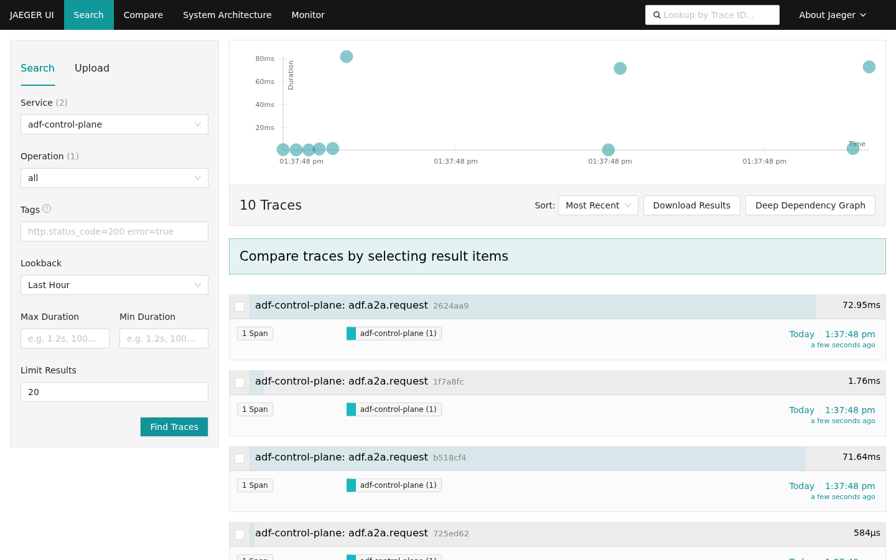
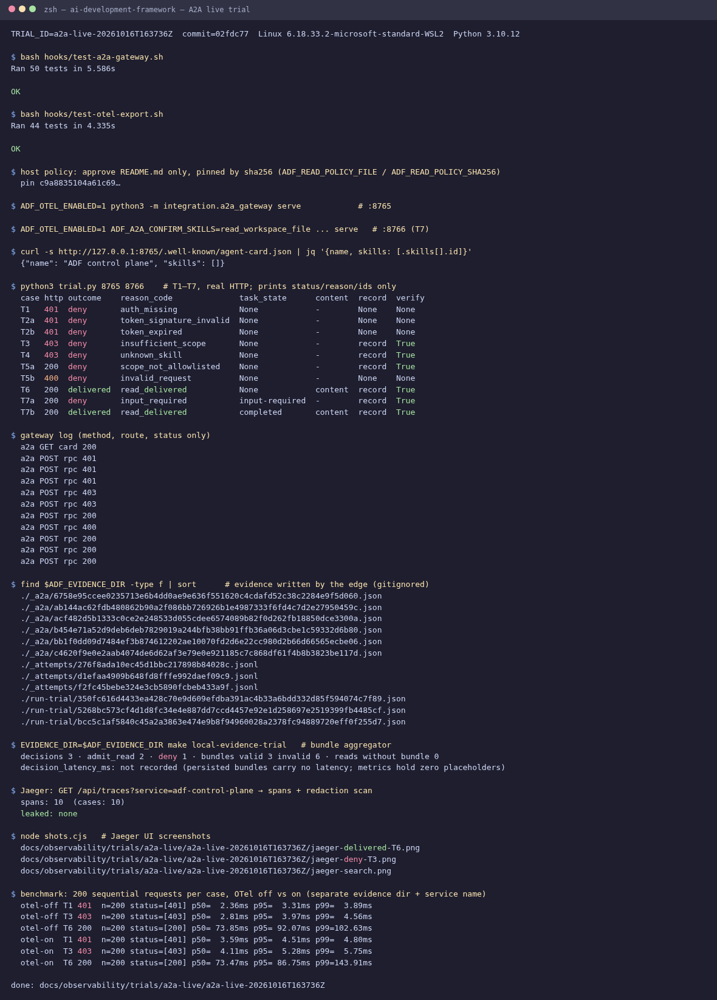

# A2A live trials

**What this proves:** an external agent that speaks A2A only gets what the host allows. Every decision, admit or deny,
comes with a reason code, every decision made after AuthN leaves verifiable evidence, and the same story shows up in
an observability UI with no credentials in it.

Real HTTP against `python3 -m integration.a2a_gateway serve`; no mocks.

## Latest repeatable run · [a2a-live-20261019T153027Z](a2a-live-20261019T153027Z/report.md)

`make a2a-live-trial` at `87e50f3`: **12/12 as expected**, 7/7 records pass `verify_record`, 0 leaks.
T5d (`config/.env`) is a verified 200 `invalid_scope` deny since WP1b. No Jaeger or benchmark in this run.
Previous run before WP1b: [a2a-live-20261019T144544Z](a2a-live-20261019T144544Z/report.md).

## Latest manual run · [a2a-live-20261016T163736Z](a2a-live-20261016T163736Z/report.md)

| | |
| --- | --- |
| Cases | **10/10 as expected** (T1–T7: 401 ×3, 403 ×2, 400, policy deny, delivered, pause → human confirms → delivered) |
| Evidence | **6/6 records** pass `verify_record`; 3 Evidence Bundles |
| Observability | **10/10 spans** in Jaeger · **0** leaks (token, `sub`, path, content) · Langfuse skipped |
| Deny latency | **~2–3 ms p50** (401/403) · OTel export adds ~1.2 ms |
| Delivered read latency | **~74 ms p50** (PDP → PEP → read → evidence) · OTel overhead in the noise |
| Pre-trial gates | `test-a2a-gateway` 50 OK · `test-otel-export` 44 OK |



<details><summary>Terminal of the full run (tests → trial → evidence → Jaeger → benchmark)</summary>



Text version: [`transcript.log`](a2a-live-20261016T163736Z/transcript.log).
</details>

## Two panes: what it did vs. what it was allowed to do

| Question | Where to look | Authority |
| --- | --- | --- |
| What did the agent do (turns, tools)? | Langfuse, via the agent vendor's integration | none: telemetry |
| What did ADF decide, and why? | `adf.a2a.request` span in Jaeger/Langfuse (`reason_code`, ids) | none: telemetry |
| Can I prove it later? | `evidence/_a2a/<record_id>.json` + bundle → `verify_record` | **yes**: audit of record |

From a span to the proof: copy `adf.record_id` → open `_a2a/<record_id>.json` → `verify_record`. Step by step in
[LANGFUSE.md § 3](../../LANGFUSE.md#3-correlação-span--evidência--verificação).

## Human in the loop

- **The host decides, not the agent.** The host writes the policy (which paths) and pins it by SHA-256, and the host
  marks which skills need confirmation. No field in a request changes either one.
- **A human confirms (T7).** With `ADF_A2A_CONFIRM_SKILLS`, the agent stops at `input-required`. Only a token with
  `human:confirm` for the same `sub` resumes the task, and only once.
- **A human merges.** Changes to policy, skills and ADRs go through a PR with review. These reports are evidence for
  that review, not a substitute for it.

## What this trial does *not* prove

- RS256/JWKS with a real IdP (pilot HS256 only), TLS through a proxy, or remote-network traffic.
- Concurrency or SLOs: the benchmark is sequential, a single run, on a WSL2 laptop.
- Langfuse end to end: not installed on the trial host.
- Write skills, Token Exchange, DPoP: they don't exist in the product (see the ADRs).

## Reproduce

```bash
make a2a-live-trial                      # or TRIAL_ID=a2a-live-<stamp>; ADF_OTEL_ENABLED=1 to also emit spans
make a2a-live-trial AUTH=rs256           # openssl test IdP; the gateway only holds the pinned public JWKS
```

`hooks/run-a2a-live-trial.py` starts the real gateway on `127.0.0.1` (ephemeral port) over a throwaway Git
fixture, with a host policy built by [`effect-security-read-v0`](../../../../policy-packs/effect-security-read-v0/README.md)
and an HS256 pilot secret that lives only in memory. It runs T1–T7b and re-verifies each record from disk
with `verify_record`. It writes `rows.json`, `summary.json` and `report.md` under `a2a-live/<trial_id>/`
(status, reason_code and ids only) and evidence under `evidence/_a2a_trials/<trial_id>/`, which stays local.
It exits 1 if a case differs from the matrix, a record fails, or the report contains a token, the secret,
an absolute path or file content. It never overwrites an existing trial.

Not automated: Jaeger screenshots, the latency benchmark, RS256 with a real IdP ([runbook](../../../runbooks/a2a-rs256-jwks.md)), the TLS proxy, Langfuse.
For those, use the manual pilot in [CONTROL_PLANE § Borda A2A](../../../CONTROL_PLANE.md#borda-a2a-a2a-1-a-6).

## Reading the numbers

- **HTTP 200 is not "delivered".** A PDP/PEP decision comes back as 200 with `result.outcome = "deny"`.
  Count `outcome`, not status codes.
- **`make local-evidence-trial` does not count A2A records.** It only aggregates adapter bundles. The A2A
  aggregate is the `summary.json` of this trial (`as_expected`, `records`, `verify_record_true`, `redaction_leaks`).
- **T5d changed with WP1b.** `config/.env` is denied by the PDP (`invalid_scope`) before a scope exists.
  Since 2026-10-19 that bundle verifies offline, so the edge answers 200 `outcome=deny` with a record. The run
  `a2a-live-20261019T144544Z` predates the fix and shows 500 `a2a_evidence_failed` there (no bytes left).
