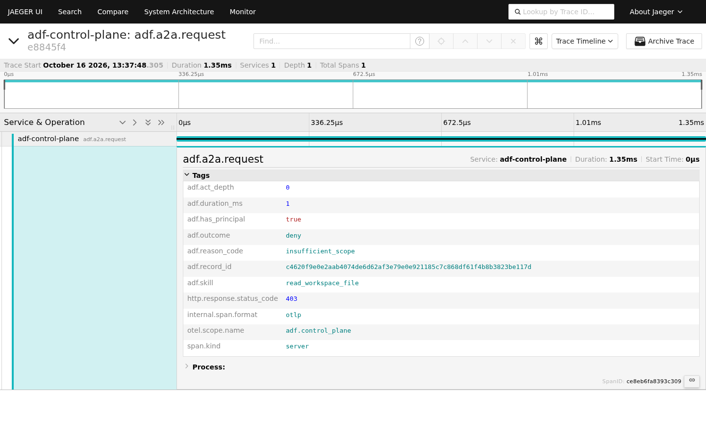
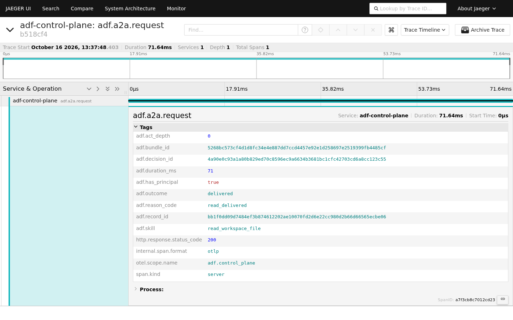

# A2A live trial · a2a-live-20261016T163736Z

| | |
| --- | --- |
| **Date** | 2026-10-16T16:37Z (UTC) |
| **Host** | Linux 6.18.33.2-microsoft-standard-WSL2 · Python 3.10.12 · Jaeger 1.62.0 |
| **Commit** | `02fdc77` |
| **Auth** | HS256 pilot. The secret was generated per run and lived only in the process env. RS256/JWKS was not exercised |
| **Gateways** | `127.0.0.1:8765` (default) · `127.0.0.1:8766` (`ADF_A2A_CONFIRM_SKILLS=read_workspace_file`, T7) |
| **Host policy** | temporary file, pinned by SHA-256 (`c9a8835104a61c69…`), approves `README.md` only, `ADF_MAX_OUTPUT_BYTES=65536` |
| **Evidence** | `docs/observability/evidence/_a2a_trials/a2a-live-20261016T163736Z/` (gitignored, `0700`) |

Artifacts in this folder: [`transcript.log`](transcript.log) · [`terminal.png`](terminal.png) ·
[`summary.json`](summary.json) (counts and benchmark) · [`rows.json`](rows.json) (one row per case:
status, reason_code, ids; never content) · Jaeger screenshots.

## Gates before the trial

| Gate | Result |
| --- | --- |
| `hooks/test-a2a-gateway.sh` | 50 tests OK |
| `hooks/test-otel-export.sh` (A2A matrix with export on + collector down) | 44 tests OK |

## Matrix (real HTTP)

| Case | Request | HTTP | outcome | reason_code | task_state | Content left the edge | Record | `verify_record` |
| --- | --- | --- | --- | --- | --- | --- | --- | --- |
| T1 | no `Authorization` | 401 | deny | `auth_missing` | — | no | — | — |
| T2a | valid token, signature altered | 401 | deny | `token_signature_invalid` | — | no | — | — |
| T2b | token with `exp` = now − 120 s | 401 | deny | `token_expired` | — | no | — | — |
| T3 | scope `other:read` | 403 | deny | `insufficient_scope` | — | no | ✓ | True |
| T4 | skill `write_workspace_file` | 403 | deny | `unknown_skill` | — | no | ✓ | True |
| T5a | `AGENTS.md` (outside host policy) | 200 | deny | `scope_not_allowlisted` | — | no | ✓ + bundle | True |
| T5b | `../../etc/passwd` | 400 | deny | `invalid_request` | — | no | — | — |
| T6 | `README.md` (approved) | 200 | delivered | `read_delivered` | — | yes | ✓ + bundle | True |
| T7a | `README.md`, skill needs confirmation | 200 | deny | `input_required` | input-required | no | ✓ | True |
| T7b | resume `taskId` with `workspace:read human:confirm` | 200 | delivered | `read_delivered` | completed | yes | ✓ + bundle | True |

The trial never writes the delivered content (T6/T7b); it records only that content left the edge.

## Evidence (relative to the evidence dir; full names in `rows.json`)

| Case | Record | Bundle | `verify_record` |
| --- | --- | --- | --- |
| T3 | `_a2a/c4620f9e0e2aab40…` | — | True |
| T4 | `_a2a/acf482d5b1333c0c…` | — | True |
| T5a | `_a2a/b454e71a52d9deb6…` | `run-trial/350fc616d4433ea4…` | True |
| T6 | `_a2a/bb1f0dd09d7484ef…` | `run-trial/5268bc573cf4d1d8…` | True |
| T7a | `_a2a/6758e95ccee02357…` | — | True |
| T7b | `_a2a/ab144ac62fdb4808…` | `run-trial/bcc5c1af5840c45a…` | True |

`verify_record` checks the schema, the hash, the principal, the link to the bundle, and `verify_offline` on the bundle.
T1/T2/T5b produce no record, by design: 401 means no identity was established, and in T5b the request schema rejects
the traversal before AuthN.

## Observability

- **Jaeger: ok.** All 10 cases appear as 10 `adf.a2a.request` spans under `adf-control-plane`. A scan of the exported
  payload finds none of `eyJ`, `Bearer`, `sub`, paths or `content`.
- **Screenshots:** the expected tags were checked in the DOM at capture time: the list shows 10 traces, T3 shows
  `insufficient_scope`, and T6 shows `read_delivered` plus `decision_id` / `bundle_id` / `record_id`.
- **Langfuse: skipped** (not installed on this host; see [LANGFUSE.md](../../../LANGFUSE.md)).

| Search | T3 deny | T6 delivered |
| --- | --- | --- |
|  |  |  |

## Benchmark

200 sequential requests per case after 10 warm-up requests, client wall clock, loopback, on two separate gateways
(OTel off / OTel on with `ADF_OTEL_SERVICE_NAME=adf-control-plane-bench`) and a separate evidence dir.

| Case | p50 off → on | p95 off → on | p99 off → on |
| --- | --- | --- | --- |
| T1 401 `auth_missing` | 2.36 → 3.59 ms | 3.31 → 4.51 ms | 3.89 → 4.80 ms |
| T3 403 `insufficient_scope` | 2.81 → 4.11 ms | 3.97 → 5.28 ms | 4.56 → 5.75 ms |
| T6 200 `read_delivered` | 73.85 → 73.47 ms | 92.07 → 86.75 ms | 102.63 → 143.91 ms |

What this run shows:
- **Denies are cheap:** 401/403 come back in about 2–3 ms. Export adds about **+1.2 ms p50**, which is the cost of
  serializing the span and starting the thread on the request path. The `POST` itself goes out in the background.
- **A delivered read costs about 74 ms p50**, and export overhead disappears in the noise. Most of that time is the
  PDP → PEP → read → Evidence Bundle + record path. This run did not profile that time, so no step is named as the cost.
- **p99 of T6 with OTel (144 ms) is a single-run tail,** not a measured trend. Repeat the run before drawing conclusions.

Limits: one run, sequential (no concurrency), loopback on WSL2, a laptop as the host. These are not SLOs.

## Aggregator

`make local-evidence-trial` aggregates **Evidence Bundles**. It saw the 3 bundles as valid and counted the 6 `_a2a/`
records as "invalid bundles" (`bundles_total` 9 = 3 + 6), so its numbers do not apply to A2A. The authoritative
counts are the table above and `summary.json`.

## Residual risks observed

- `local-evidence-trial` does not understand `_a2a/` records (follow-up: an A2A-aware aggregator, or skip `_a2a/`).
- A policy deny on an authenticated request (T5a) returns **HTTP 200** with `outcome=deny`; scope and skill denies return 403.
  Clients have to read `outcome`.
- T5b is stopped by the schema before AuthN, so it leaves only the log line and the span.
- The public agent card lists `skills: []`: protected skills only appear on the authenticated card. This is by design.
- HS256 pilot: whoever holds the secret mints any `sub`/scope. RS256/JWKS was outside this run.
- The trial harness (`trial.py`, `bench.py`) is not in the repo yet. See "Reproduce" in [README](../README.md).
