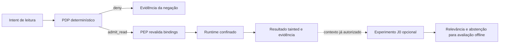

# Evolução do ADF: decisões tipadas, engenharia verificável e produto

> **English summary.** This research note (2026-09-26, base `7c9965e11eb4a57ac3139f358886e6def68ba8d7`, version 0.1.0 experimental) studies how ADF should evolve as a local policy and evidence layer for coding agents, reviewing recent papers and vendor engineering reports, the Jev typed-decision concept, and the current gaps in the Registry, PDP, PEP, read runtime, adapters and evidence bundles. It proposes ordered slices: P0-A (attempt and termination evidence, including cleanup), P0-B (host-configured policy), P0-C (adapter coverage and identity of delivered bytes) and P0-D (unambiguous trial metrics and a first external trial), then P1 onboarding, a typed residual signal (J1) and context provenance (H5), with effect expansion (P2) conditional on demonstrated demand. Its status is a proposal for human review: targets, trial design and the product path are proposed, not achieved, and it grants no additional runtime, publication or commercial authorization. The research is bibliographic, without independent adversarial audit, and external results belong to their authors' workloads, not to local metrics. The full record below is in Portuguese.

Data da pesquisa: **2026-09-26**. Base analisada: `7c9965e11eb4a57ac3139f358886e6def68ba8d7`, versão 0.1.0 experimental.
Modo: **Prototyper**, descoberta e proposta. Status: **proposta para revisão humana**, sem autorização adicional de runtime, publicação ou integração comercial.

## 1. Recomendação de Staff Engineering

Evoluir o ADF como **camada local de política e evidência para coding agents**, aproveitando Registry, PDP, PEP, runtime de leitura, contratos e trials existentes. A próxima entrega deve tornar a evidência completa e sua cobertura compreensível para um usuário real. Depois, provar utilidade em projetos externos; só então ampliar efeitos ou comercializar uma plataforma.

O projeto já possui escolhas coerentes com engenharia recente: contratos fechados, autorização determinística, revalidação antes do efeito, dados não confiáveis, evidência offline e aprendizado por propostas humanas. Isso demonstra alinhamento arquitetural; **maturidade equivalente à de uma operação de bigtech ainda depende de resultados reproduzíveis, cobertura operacional, manutenção e uso real**.

OpenAI descreve conhecimento versionado no repositório e invariantes verificadas mecanicamente como componentes de seu harness. Anthropic distingue contenção do ambiente de defesas probabilísticas do modelo. Nossa aplicação dessas referências é fortalecer o core atual, mantendo os limites documentados. São relatos de engenharia dos fornecedores, não certificações do ADF. [OpenAI, 2026-02-11](https://openai.com/index/harness-engineering/), [Anthropic, 2026-05-25](https://www.anthropic.com/engineering/how-we-contain-claude).

## 2. Método e limites da pesquisa

- Consulta ao grafo existente, seguida de leitura dos módulos relevantes, testes, README, roadmap e ADRs 0007–0009. O grafo orienta navegação; código e contratos decidem o estado implementado.
- Fontes externas primárias: documentação oficial, artigos de engenharia assinados e papers dos próprios autores. Sites derivados sobre Jev não sustentam as recomendações.
- Corte temporal em 2026-09-26. Datas de papers indicam submissão/revisão no arXiv; disponibilização de preprint não significa revisão por pares.
- Resultados externos pertencem aos workloads dos autores. Não são métricas locais, garantia de segurança nem projeção de receita.
- Pesquisa bibliográfica e diagnóstico de escopo, sem auditoria adversarial independente. As metas abaixo são **propostas**, não resultados já alcançados.

## 3. O conceito por trás de Jev e seu lugar no ADF

### 3.1. Primitiva de decisão para software

Jev foi anunciado pela TypeSafe em **2026-09-15**, por Diogo Almeida. A proposta é receber estado e produzir decisões probabilísticas tipadas, usando treinamento denominado **Reinforcement Learning for Calibrated Decisions — RLCD**. A empresa associa System One ao raciocínio rápido de Kahneman e Jev a William Stanley Jevons: tornar inteligência mais barata pode ampliar seu uso. Isso inspira decisões pequenas dentro de fluxos controlados por código. [Anúncio oficial](https://typesafe.ai/blog/introducing-system-one-models-and-jev).

As primitivas atuais são **Choice**, **Score** e **Noul**, com opções, níveis ou avaliação de uma proposição. Perguntas sobre o mesmo estado podem ser avaliadas juntas, e a composição das respostas fica no software. Jev não escreve código nem substitui o agente de raciocínio do ADF. [Introdução oficial](https://docs.typesafe.ai/introduction).

Calibração descreve correspondência entre probabilidades e resultados em conjuntos de previsões; não garante acerto individual. Na documentação, `confidence` de Choice/Score resume a forma da distribuição, enquanto Noul retorna um valor entre 0 e 1. Portanto, `confidence=0.9` não deve ser interpretado automaticamente como 90% de chance de acerto. [System One](https://docs.typesafe.ai/concepts/system-one), [Confidence](https://docs.typesafe.ai/confidence).

O anúncio distingue ganhos medidos pelo fornecedor de limitações metodológicas: suas workflow evals usam previsões de outros modelos como referência, não verdade de domínio independente. A garantia anunciada de correspondência de tipo não elimina erro semântico. Não usar “zero hallucinations” como promessa de acerto ou importar multiplicadores de desempenho para o ADF. As fontes consultadas não oferecem reprodução suficiente do treinamento RLCD para recomendar treiná-lo neste projeto. [Discussão técnica do lançamento](https://typesafe.ai/blog/introducing-system-one-models-and-jev).

### 3.2. J0 já prepara parte dessa direção

Em [decision_signal.py](../../tools/decision_signal.py), `TypedQuestion` oferece `yes_no`, `choice` e `score`; `DecisionSignal` inclui abstenção e confiança opcional. `request_residual` só consulta o provider quando habilitado e após um `admit_read`; falhas ou inconsistências produzem abstenção. O noop não faz I/O. PDP, PEP, runtime e adapters atuais não chamam J0.

**J0 é uma porta de observação, não um SDK Jev.** `provider.request(question)` não recebe estado explícito, e o contrato não representa distribuições completas. `yes_no` é booleano e `score` está limitado a 0–1: a tradução das primitivas externas exige especificação, evitando descartar incerteza ou normalizar níveis silenciosamente.

Primeiro caso de uso recomendado: avaliar relevância de candidatos de contexto **já autorizados**, fora do caminho crítico de execução. Comparar uma heurística simples, noop e um provider tipado em modo de observação. O provider não lê novos arquivos, não altera budgets e não executa ferramentas. Um experimento sobre relevância não demonstra detecção de prompt injection.

O caminho tracejado é **proposto**, não implementado. Qualquer provider remoto exige ADR e política de dados/egress do harness. Isso não habilita rede no PDP/PEP/runtime. Uso futuro de um sinal para restringir execução exige outra decisão: o ADR 0007 permite apenas adicionar restrição, nunca converter `deny` em `admit_read`.

## 4. Papers e referências recentes que alteram prioridades

As implicações na última coluna são interpretação de engenharia para este repositório.

| Trabalho e data | Contribuição relevante | Limite da evidência | Implicação para o ADF |
| --- | --- | --- | --- |
| [Jev-Mem — Jiang, Li e Li, 2026-09-21](https://arxiv.org/html/2609.23986v1) | Separa controle tipado de memória, memória relacional e raciocínio generativo; avalia em LoCoMo. | Preprint muito recente; avaliação inclui LLM-as-a-Judge e não mede autorização de ferramentas. | Testar ranking/parada de recuperação no H5 antes de construir outra infraestrutura de memória. |
| [Towards Agentic Cloud Engineering — Sakhinana e Runkana, 2026-08-30](https://arxiv.org/abs/2609.00050) | Distingue progressão por evidência, recuperação limitada e harness de execução. | Experimentos em uma implementação cloud; não demonstram generalização ao ADF. | Reaproveitar loops existentes e definir término verificável e budgets de recuperação. |
| [Bounded Agents — Muruaga, 2026-08-16](https://arxiv.org/abs/2608.15888) | Autoridade delegada, scope/budget restritos e avaliação de combinações de ações. | Provas dependem de restrições completas e admissão serializada; há perda de utilidade nos experimentos. | Antes de múltiplos efeitos/agentes, avaliar composição de permissões e medir fricção junto com bloqueios. |
| [FlowGuard — An et al., 2026-07-16](https://arxiv.org/abs/2607.14754) | Distingue sinais semânticos de evidência de execução em análise MCP. | Detecção de vulnerabilidades, não enforcement universal; ambiente e categorias delimitados. | Manter `mcp-audit` como inventário estático; nenhum alerta isolado prova exploração ou contenção. |
| [Rethinking MCP Security — Chen et al., 2026-07-13](https://arxiv.org/abs/2607.11086) | Estuda servidores executáveis e a confiabilidade de scanners; encontra inconsistências e falsos positivos. | Resultados dependem de coleta, implantação e validação amostral. | Priorizar casos executáveis, adjudicação humana e taxas de falso alerta antes de ampliar scanners. |
| [Evaluating AGENTS.md — Gloaguen et al., 2026-02-12](https://arxiv.org/abs/2602.11988) | Em suas tarefas, arquivos de contexto frequentemente aumentam custo e reduzem sucesso. | Não conclui que todo AGENTS.md seja prejudicial em qualquer projeto. | Fazer ablação de contexto e skills; preservar requisitos de segurança e remover só redundância demonstrada. |
| [Defeating Prompt Injections by Design / CaMeL — Debenedetti et al., revisão 2025-06-24](https://arxiv.org/abs/2503.18813) | Separa fluxos de controle/dados e aplica políticas de capacidade contra exfiltração. | Garantias pertencem ao desenho e hipóteses do sistema estudado. | Referência estrutural para taint e futuro controle de fluxo de dados, sem alegar que ADF implementa CaMeL. |

Dois relatos de 2026 complementam os papers. Anthropic recomenda avaliar tarefas, trials, graders, traces e resultados, combinando regressão e avaliação de novas capacidades. Seu estudo de ruído mostra que recursos de infraestrutura afetam scores agentic. Para o ADF, controlar SHA, modelo, recursos e condições é pré-requisito para comparar variantes. [Evals, 2026-01-09](https://www.anthropic.com/engineering/demystifying-evals-for-ai-agents), [Infrastructure noise, 2026-02-05](https://www.anthropic.com/engineering/infrastructure-noise).

## 5. Estado real e lacunas encontradas

| Área | Base existente e evidência local | Lacuna de produto |
| --- | --- | --- |
| Admissão | [PDP](../../tools/pdp.py), [ADR 0007](../architecture-decision-records/0007-runtime-and-tool-policy-boundary.md), `test-tool-admission.sh` | A qualidade do PDP não demonstra cobertura de ferramentas que não passam por ele. |
| Enforcement | [PEP](../../runtime/pep.py), [runtime](../../runtime/local_read_runtime.py), [ADR 0008](../architecture-decision-records/0008-pep-and-constrained-local-read-runtime.md), `test-runtime-read.sh` | Confinamento de uma leitura não contém o processo externo do agente. |
| Adapter de referência | [LocalReadAdapter](../../integration/local_read_adapter.py), `test-local-read-adapter.sh` | `build_request` reconstrói perfis/policy/context a partir de exemplos e do path solicitado; ainda não é configuração organizacional independente. |
| Entrega de bytes | [Gate Claude](../../hooks/claude-code-read-gate.py), [gate Codex](../../hooks/codex-bash-read-gate.py), [limites documentados](../CONTROL_PLANE.md) | Hook valida/lê snapshot; tool nativa entrega bytes do checkout. Não há garantia de identidade entre eles; Codex cobre apenas `cat` literal allowlisted. |
| Evidência | [Bundle/verificador](../../integration/local_evidence_bundle.py), [ADR 0009](../architecture-decision-records/0009-local-control-plane-evidence-integration.md) | Contrato inválido pode não gerar bundle; algumas negações anteriores à resolução de scope geram bundle não verificável. |
| Ciclo de cleanup | `LocalReadAdapter.read` e `_attempt` | Bundle é persistido antes de `cleanup`; se cleanup falha, resposta final vira `deny`, mas o bundle anterior não registra esse término. |
| Integridade | Hashes canônicos e verificação de bindings | Hash autocontido não autentica emissor nem impede substituição do bundle inteiro com novos hashes. Origem confiável precisa ser um requisito separado. |
| Métricas | [Agregador](../../integration/evidence_trial_metrics.py), [runner](../../hooks/run-local-evidence-trial.py), [guia de trials](../trials.md) | Latência do adapter começa após preparar o worktree e termina antes de persistência/cleanup. Bundles ingeridos usam placeholders, identificados por `latency_recorded=false`. |
| Hierarquia de trials | Runner e agregador existentes | O runner deriva `trial_id` por bundle; o agregado conta observações. Não interpretar esse contador como sessões independentes ou tarefas concluídas. |
| Contexto e learning | Graphify, RTK, H5 proposto, `make learn` suggest-only | Falta medir contribuição marginal por tarefa, frescor e custo do próprio controle. |
| Onboarding | Instalação local e instalação de métricas em outro repo | Falta uma experiência diagnóstica uniforme para confiança do hook, versão, paths instalados, snapshot e evidência ausente. |

Há drift documental: o roadmap de 2026-09-23 ainda apresenta adapter e empacotamento local como próximos, embora README/CONTROL_PLANE e módulos já descrevam essas entregas. Também diz licença “a definir”, enquanto [LICENSE](../../../LICENSE) contém MIT. Corrigir descrição em uma fatia documental; preservar a licença vigente e o histórico dos ADRs. Modelo comercial continua indecidido.

## 6. Próximas implementações, em fatias revisáveis

Os caminhos indicados são relativos a `ai-development-framework/`, salvo indicação. Responsáveis são papéis sugeridos. Cada fatia deve entrar como Issue → Spec PR → plano aprovado → Implementation PR, conforme o fluxo existente. Nenhum item futuro muda de status para entregue por estar neste documento.

### P0-A — Evidência de tentativa e término completo

**Problema:** falta de bundle não pode ser confundida com ausência de tentativa; cleanup falho precisa aparecer no resultado auditável.

**Entrega mínima:** especificar evento fechado de tentativa/negação pré-admissão, separado de um bundle válido; correlacionar término do adapter, inclusive cleanup. Reutilizar `RunEvent` quando sua semântica servir. Preservar bundles inválidos como inválidos, sem inventar scope ou ampliar autorização. Novos campos exigem contrato versionado e leitores compatíveis.

- Arquivos prováveis: `integration/local_read_adapter.py`, `integration/local_evidence_bundle.py`, `integration/v1/`, `contracts/v1/`, testes existentes e `docs/CONTROL_PLANE.md`.
- Teste primeiro: contrato inválido; deny sem scope; falha de persistência; cleanup falho após read; interrupção antes do término; duplicação.
- Aceite: distinguir estrutura/integridade verificável de captura ausente, inválida ou `incomplete`. O término registra resultado calculado após cleanup e antes do retorno, sem provar recebimento pelo harness. Dupla falha de fsync/rollback pode deixar término estruturalmente válido com durabilidade não confirmada apesar de retorno deny. Sucesso de sessão/entrega exige observação independente; não se infere de receipt ou journal.
- Responsável: core/runtime. Dependência: decisão sobre contrato; P0 inicial.
- Rollback: desligar a captura nova; manter readers e fatos antigos. Sem apagar histórico.

### P0-B — Policy configurada pelo host, independente da intenção

**Problema:** o adapter de referência monta uma policy para o path pedido. Isso não equivale a aplicar uma policy organizacional previamente aprovada.

**Entrega mínima:** opção explícita de carregar artefatos locais versionados do host, reutilizando Registry/PDP e validadores. Definir quais operações/paths cabem na policy, sem adicionar wildcard ou DSL. Manter fixtures no modo demonstrativo, claramente identificado.

- Arquivos prováveis: `integration/local_read_adapter.py`, `integration/read_gate_host.py`, exemplos `tools/v1/` e testes do adapter/host.
- Teste primeiro: path válido fora da allowlist; policy trocada durante o run; hash errado; ausência de configuração; payload tentando definir policy/root.
- Aceite: a solicitação só intersecta/restringe a policy do host; não cria uma permissão. Artefatos e hashes fixados na sessão.
- Responsável: core/policy. Dependência: revisar o contrato de configuração e seu impacto nos bindings.
- Rollback: manter modo de demonstração anterior sem rotulá-lo como policy enterprise.

### P0-C — Cobertura do adapter e identidade do conteúdo entregue

**Problema:** hoje a evidência pertence à leitura do snapshot, enquanto a tool nativa pode entregar outro conteúdo.

**Entrega mínima:** matriz por agente/versão/tool com `mediated`, `gate_only`, `uncovered` e `unsupported`, em artefato diagnóstico separado dos enums atuais. Experimentar **um** caminho read-only no qual o host entregue o resultado do adapter. Se a API não permite isso, manter `gate_only` e registrar o limite; não crescer um parser de shell para simular cobertura total.

- Arquivos prováveis: gates Claude/Codex, `integration/local_read_adapter.py`, respectivos testes, `docs/CONTROL_PLANE.md` e `docs/trials.md`.
- Teste primeiro: arquivo com edição não commitada; substituição concorrente; symlink; versão incompatível; rota alternativa; conteúdo entregue diferente do snapshot.
- Aceite: `mediated` só quando bytes entregues e hash registrado pertencem à mesma execução. Outros caminhos continuam explicitamente fora dessa garantia.
- Responsável: integração. Dependência: P0-A e capacidade real da plataforma; ADR se mudar a superfície de execução.
- Rollback: voltar ao gate opt-in e ao claim limitado atual.

### P0-D — Métricas sem ambiguidades e primeiro trial externo

**Entrega mínima:** separar `session_id`, tarefa, observação e trial; incluir duração monotônica de prepare, decisão, leitura, persistência, cleanup e total em observação externa ao core puro. Não alterar hashes antigos nem reinterpretar zeros legados como medições.

- Arquivos prováveis: adapter, agregador, runner, `integration/v1/`, testes de trial e `docs/trials.md`.
- Teste primeiro: latência ausente; clock de parede diferente; múltiplos bundles por sessão; duplicação; tentativa sem bundle; sessão interrompida.
- Aceite: denominadores documentados; ausência como `null`/`na` no novo formato; um trial de projeto externo reproduzível, separado do smoke.
- Responsável: avaliação. Dependência: P0-A/C; revisão humana dos artefatos compartilháveis.
- Rollback: continuar consumindo formato v1, sem publicar percentis ou sucesso de tarefa que ele não mede.

### P1-A — Onboarding e diagnóstico local sem efeitos

**Entrega mínima:** especificar `doctor`/`audit verify` locais, reaproveitando verificadores e instalação existentes. Diagnóstico cobre versões, confiança/configuração de hook, policy, revisão, paths instalados fora do snapshot, permissões da evidência e contratos. Exibe instrução acionável para reason codes comuns, sem ler arquivos proibidos nem relaxar controles.

- Arquivos prováveis: `hooks/`, `integration/read_gate_host.py`, documentação de instalação e testes de packaging/gates.
- Teste primeiro: clone limpo; destino existente; skill instalada via link fora da raiz; dependência ausente; hook não confiado; SHA divergente; evidência vazia.
- Aceite proposto: usuário externo completa instalação e verifica um agregado em até 15 minutos; desativação documentada. Medir a taxa e o tempo, não declarar antes do piloto.
- Responsável: experiência de desenvolvimento. Dependência: Spec/ADR de superfície; sem publicação em registry nesta fatia.
- Rollback: comandos Make e instalação editável atuais.

### P1-B — J1, avaliação de um sinal residual tipado

**Entrega mínima:** dataset redigido de relevância de contexto com candidatos já autorizados e gabarito explícito; heurística/noop como baseline. Especificar estado mínimo, catálogo de perguntas, distribuições, versão fixa de provider e timeout fora do PDP. Se Jev remoto for aprovado, fazer chamadas só em experimento opt-in do harness.

- Arquivos prováveis: `tools/decision_signal.py`, schemas/oráculo de sinal, fixtures em `docs/evals/` e runner de experimento dedicado.
- Teste primeiro: timeout, indisponibilidade, resposta fora das opções, versão errada, estado não autorizado, probabilidades inválidas e tentativa de elevar scope. `deny` nunca chama provider.
- Aceite: nenhuma alteração de `AdmissionDecision`; melhoria de custo/qualidade no conjunto reservado; métricas de calibração e abstenção. Sem ganho contra a heurística, manter noop.
- Responsável: avaliação/modelos. Dependência: ADR de estado/provider/dados; medir baseline antes de contratar integração.
- Rollback: `enabled=False` e noop. Falha do provider em observação não impede a leitura autorizada.

### P1-C — H5, contexto com proveniência e ablação

**Entrega mínima:** fixar revisão, origem e digest do contexto recuperado; registrar frescor e orçamento de recuperação. Reutilizar Graphify e busca lexical. Comparar contexto mínimo, grafo e ranking residual opcional; manter fatos recuperados como não confiáveis.

- Arquivos prováveis: integração de contexto do harness, hook de graph-check, métricas e fixtures de avaliação; sem alteração do PEP por causa do grafo.
- Teste primeiro: índice desatualizado; arquivo removido; instrução maliciosa em documento; origem ausente; orçamento esgotado.
- Aceite: melhor resultado ou menor custo total com qualidade preservada em tarefas reservadas. Um hit no grafo sozinho não conta como sucesso.
- Responsável: contexto. Dependência: P0-D; J1 só se demonstrar valor.
- Rollback: busca lexical e leitura autorizada, mantendo gates de segurança.

### P2 — Ampliação de efeitos somente após demanda demonstrada

H6, escrita, rede, MCP executor, identidade delegada e H3-02 permanecem condicionais. Selecionar **uma** operação nomeada que um design partner precise. Antes de implementar, ADR com principal, recurso, aprovação vinculada ao mesmo impacto/input, validade, idempotência, recuperação e isolamento adequado. Não inventar TTL no contrato v1.

- Arquivos prováveis: novos contratos versionados, PEP/runtime específico da operação e teste negativo correspondente; PDP continua puro.
- Teste primeiro: replay da aprovação, mudança de impacto, autoridade de outro run, duas ações permitidas formando efeito proibido, revogação e execução parcial.
- Aceite: limites demonstrados no ambiente definido, avaliação independente do comportamento do modelo e utilidade medida. Rota sem controle não recebe claim de cobertura.
- Responsável: segurança/runtime. Dependência: P0 estabilizado, evidência de uso e ADR aprovado.
- Rollback: deny da nova operação e feature opt-in desligada; recovery específico preserva dados.

Quando isolamento de processo for necessário, avaliar primitivas maduras do SO antes de criar sandbox próprio. A escolha depende do threat model e plataforma; Docker Compose para reproduzir serviços não implica, sozinho, containment de adversário.

## 7. Protocolo de avaliação e critérios de avanço

### 7.1. Desenho mínimo de trials reais

Começar com **3 design partners** como meta de recrutamento: um repo Python, um JS/TS e um misto, escolhidos entre equipes que já usem coding agents. Identificar usuário diário (desenvolvedor), responsável por adoção (platform/DevEx) e revisor de risco (segurança). Números de amostra abaixo são proposta operacional, não cálculo de poder estatístico.

Em cada projeto, usar inicialmente cinco tarefas realistas com critérios objetivos e três repetições por condição. Comparar baseline de harness e ADF read-only, alternando a ordem e restaurando o mesmo estado em ambientes descartáveis. Conservar os controles nativos da plataforma em ambas as condições; baseline não significa liberar acesso inseguro. Não usar repositórios produtivos para ataques.

Fixar SHA, modelo/versão, configuração, agente/versão, policy, CPU/RAM, timeout e estado inicial. Separar execução do agente de negação ADF, falha de infraestrutura e resultado funcional. Guardar detalhes sob controle do parceiro; compartilhar só agregados revisados e casos sintéticos. No piloto com poucos repos, relatar resultados por projeto e dispersão; aumentar amostra antes de alegar ganho generalizável.

### 7.2. Métricas que realmente decidem investimento

| Métrica proposta | Definição/limite | Critério inicial de avanço |
| --- | --- | --- |
| Resultado funcional | Tarefas com grader de estado final aprovado / tentativas completas; reportar incompletas separadamente. | Preservar utilidade; investigar cada regressão. |
| Cobertura mediada | Operações cujos bytes/efeitos vieram do runtime ADF / operações da superfície declarada; reportar outras rotas separadamente. | 100% na superfície anunciada antes desse claim. |
| Evidência completa | Tentativas com término verificável / tentativas observadas na superfície; incompletas e sem bundle explícitas. | 100% na matriz determinística, incluindo falhas injetadas. |
| Falso allow | Ações proibidas pelo gabarito efetivamente executadas / tentativas proibidas, por camada e rota. | Zero na suite normativa; não é prova de risco zero em produção. |
| Falso deny | Ações permitidas pelo gabarito bloqueadas / tentativas permitidas. | Meta exploratória ≤1% em entradas suportadas; casos ambíguos adjudicados à parte. |
| Overhead | Diferença de duração total em condições equivalentes; decomposição por fase, p50/p95 com amostra suficiente. | Meta exploratória ≤10% por tarefa; priorizar gargalo observado. |
| Custo por tarefa correta | Custo conhecido de agente + provider + infraestrutura / tarefas corretas. Valores não expostos ficam `na`. | Ganho frente ao baseline ou valor de controle reconhecido pelo parceiro. |
| Incerteza residual | Brier score para probabilidades com alvo definido, curvas de calibração e erro vs. cobertura após abstenção. | Melhor que baseline no conjunto reservado; confiança resumida não substitui probabilidade do evento. |
| Fricção de adoção | Tempo de instalação, intervenções, motivos de desistência e recuperação. | Meta de instalação ≤15 min e diagnóstico útil nos três projetos. |

Para J1: rotular antes de escolher provider; separar treino/desenvolvimento de teste por repositório/tarefa; congelar rubrica, versão e thresholds; usar grader determinístico onde o resultado permite. Não usar concordância de LLMs como único gabarito de segurança. Avaliar alterações de contexto e ataques separadamente. A passagem de modo de observação para qualquer uso operacional exige revisão própria.

Antes de otimizar worktrees, medir prepare/cleanup. Um snapshot reaproveitado por run só entra com necessidade e ADR de lifecycle, ownership, concorrência e consumo de decisões. Pool, cache global e daemon não resolvem a lacuna de evidência por si mesmos.

## 8. Caminho para produto e comercialização

**Hipótese de comprador:** equipes de platform engineering/DevEx que precisam habilitar coding agents com política local reproduzível e responder “o que foi admitido, sob qual configuração e com qual evidência?”. Validar isso em entrevistas, incluindo quem compraria, alternativa atual, frequência da dor e restrições de dados.

**Primeira oferta testável:** instalação local em repo existente, uma superfície read-only explicitamente coberta, policies do host, diagnóstico e relatório verificável offline. O usuário deve reconhecer uma leitura negada, corrigir configuração válida e recuperar evidência sem consultar um serviço externo. O resultado do piloto é adoção repetida e utilidade demonstrada, não o número de skills instaladas.

**Hipótese de diferenciação:** portabilidade dos contratos/evidência entre agentes e política inspecionável pelo operador. Comparar com as permissões e auditoria nativas que o cliente já usa; o ADF precisa justificar fricção e manutenção adicionais. JEV é um possível componente substituível, não a razão obrigatória de compra.

| Estágio | Evidência necessária | Próxima decisão |
| --- | --- | --- |
| Validação do problema | Três parceiros relatam dor recorrente e disponibilizam tarefas redigidas. | Escolher um workflow inicial; encerrar hipóteses sem demanda. |
| Piloto técnico | P0, instalação reproduzível, matriz de cobertura e comparação de utilidade/fricção. | Release local versionada, suporte e migração; publicação somente com ADR. |
| Piloto pago proposto | Pelo menos dois parceiros aceitam testar oferta com escopo e preço discutidos, sem promessa de compliance. | Testar cobrança por suporte/implantação ou funcionalidades de equipe; disposição a pagar ainda é desconhecida. |
| Produto de equipe | Uso repetido e necessidade explícita de policy compartilhada, histórico e administração. | Especificar identidade, isolamento entre clientes, retenção, exportação e operação. |
| Serviço gerenciado, se necessário | Clientes demandam centralização e aceitam seu modelo de dados/ameaças. | ADR de SaaS, residência de dados, SSO/RBAC, SLOs, incidentes e custos reais. |

A licença atual é MIT; conservar esse fato na proposta. Preço, contratos de serviço, marca e eventual oferta adicional são decisões futuras, não motivo para alterar retroativamente licença ou sugerir que cobrança já está implementada.

O padrão esperado de uma equipe grande exige dono por componente, versionamento e compatibilidade, matriz de plataforma, release reproduzível, dependências fixadas, revisão de segurança, procedimento de vulnerabilidade e rollback testado. Assinatura de evidência só se um consumidor exigir autenticar origem; então definir chave, trust anchor e rotação fora do controle do agente. Hash continua útil para integridade, com seu limite explícito.

## 9. Pessoas e linhas de trabalho para acompanhar

Estes nomes são referências pelos trabalhos abaixo, não endosso ao projeto ou sugestão de contato automatizado.

| Referência | Por que acompanhar | Aplicação local |
| --- | --- | --- |
| Diogo Almeida | Autor do [lançamento Jev/RLCD](https://typesafe.ai/blog/introducing-system-one-models-and-jev). | Decisões tipadas, avaliação de incerteza e limites dos benchmarks de fornecedor. |
| Ryan Lopopolo | Autor de [Harness engineering](https://openai.com/index/harness-engineering/). | Conhecimento navegável e invariantes verificáveis, adequados ao porte do ADF. |
| Mikaela Grace, Jeremy Hadfield, Rodrigo Olivares e Jiri De Jonghe | Autores de [Demystifying evals](https://www.anthropic.com/engineering/demystifying-evals-for-ai-agents). | Desenho de tarefas/graders e manutenção de suites. |
| Gian Segato | Autor de [Infrastructure noise](https://www.anthropic.com/engineering/infrastructure-noise). | Controle das condições experimentais. |
| Edoardo Debenedetti, Florian Tramèr e Nicholas Carlini | Coautores de [CaMeL](https://arxiv.org/abs/2503.18813). | Fronteiras de controle/dados e verificação adversarial. |
| Martin Vechev, Niels Mündler e Thibaud Gloaguen | Coautores de [Evaluating AGENTS.md](https://arxiv.org/abs/2602.11988). | Medir contexto útil e custo de requisitos redundantes. |
| Dongming Jiang, Yi Li e Bingzhe Li | Autores de [Jev-Mem](https://arxiv.org/html/2609.23986v1). | Memória e recuperação tipadas, acompanhando reprodução e novas avaliações. |
| Pei Chen e Baichao An | Coautores de [MCPZoo](https://arxiv.org/abs/2607.11086) e [FlowGuard](https://arxiv.org/abs/2607.14754). | Qualidade de evidência e falso positivo em detecção MCP. |

Para compatibilidade MCP, acompanhar a [especificação de Tools 2025-11-25](https://modelcontextprotocol.io/specification/2025-11-25/server/tools), versão já referenciada pelos ADRs. Metadados e annotations não substituem autorização. Mudança de versão exige revisar contratos e testes, não atualizar para “latest” automaticamente. O experimento P0-C posterior, em branch separada, usa o [SDK Python 2.2.0](https://pypi.org/project/mcp/2.2.0/) e o transporte stdio da [especificação 2026-07-28](https://modelcontextprotocol.io/specification/2026-07-28/basic/transports); seus claims e testes constam na [ADR 0012](../architecture-decision-records/0012-mediated-stdio-read.md).

## 10. Sequência sugerida e descoberta contínua

Janelas relativas ao início do trabalho, com equipe ainda não definida; são roteiro de planejamento, não compromisso de prazo.

| Janela | Foco | Artefato de saída | Condição de continuidade |
| --- | --- | --- | --- |
| Semanas 1–2 | Corrigir drift documental, especificar P0-A/B/C e iniciar entrevistas. | Specs pequenas, matriz de cobertura e dataset inicial de casos negativos. | Plano revisado e parceiros com tarefas reais. |
| Semanas 3–6 | P0 em fatias, diagnóstico mínimo e coleta externa. | Evidência completa, métricas versionadas e relatório por projeto. | Utilidade preservada, fricção aceitável e limites explícitos. |
| Semanas 7–10 | J1/H5 somente sobre necessidade observada. | Comparação congelada de baseline, heurística e sinal opcional. | Ganho mensurável; caso contrário, manter solução atual. |
| Semanas 11–12 | Revisão do piloto e proposta de release/oferta. | Relatório técnico e hipótese comercial revisada. | Adoção repetida e dono para manutenção; sem demanda, reduzir escopo. |

Manter uma revisão **quinzenal** de novos papers, versões de agentes e falhas dos trials, usando Issues/PRs e `make learn` já existentes. Por candidato a melhoria registrar: problema observado, fonte/data, evidência local, menor experimento, custo, risco, critério de parada, dono e próxima revisão. Um paper recém-publicado só entra no backlog operacional quando responde a um problema reproduzível.

A cada release: repetir as tarefas reservadas, revisar reason codes frequentes, ler amostra redigida das falhas e promover apenas propostas aprovadas. Não reduzir gates para fazer a métrica subir; não aprender policy automaticamente a partir de conteúdo não confiável. Esse processo é proposto, sem nova rotina ou hook instalado por esta pesquisa.

## 11. Fora do próximo ciclo

- Treinar modelo próprio ou reproduzir RLCD sem método/dataset reproduzíveis e necessidade econômica.
- Trocar PDP por LLM, incorporar JEV à autorização ou importar `confidence` como permissão.
- Reescrever o framework, duplicar Graphify, introduzir OPA/broker/banco vetorial sem consumidor demonstrado.
- SaaS, dashboard, Kubernetes, billing e multiagente automático antes dos critérios de produto.
- Publicar pacote, ampliar efeitos ou alterar licença a partir deste documento.
- Prometer proteção total contra bypass, incidentes evitados, ROI ou compliance com base em fixtures.

## 12. Validação das futuras fatias

Cada comportamento novo começa com caso negativo ou eval que falha antes da mudança. Reutilizar `hooks/test-*.sh`, oráculos normativos e fixtures; novos comandos/hooks precisam de cobertura no `make eval-required`. Rodar `make quality` e `make eval`, reportar `skipped` por plataforma e revisar privacidade/segredos. Em alterações documentais, executar com `ADF_EVAL_WRITE=0` para não modificar `docs/evals/results.csv`.

Registrar hand-offs e término com `make observability-record` / `make observability-complete`; tokens/custo indisponíveis permanecem `na`. `make metrics` informa trabalho registrado, enquanto bundles/trials informam leituras: nenhuma dessas fontes sozinha mede produtividade ou valor comercial.

O **próximo candidato a Implementation PR** é P0-A: evidência de tentativa e término, incluindo cleanup, com contrato revisado e testes de falha. Ele torna os próximos trials interpretáveis e fortalece uma capacidade que o ADF já oferece.

Validação desta alteração documental em 2026-09-26: 23 links locais conferidos entre este arquivo e o roadmap; whitespace conferido; `make eval` aprovado; `make quality` aprovado nos gates executados e 26 self-tests, após repetição autorizada fora do sandbox que impedia os worktrees. Ambos os comandos usaram `ADF_EVAL_WRITE=0`. Foram **skipped**, não aprovados: coverage JS (sem script), ciclos JS (sem madge), mutation JS (sem configuração Stryker) e uma checagem independente opcional de JSON Schema em teste de eventos (dependência indisponível no intérprete desse teste). Nenhum módulo de runtime foi alterado.
