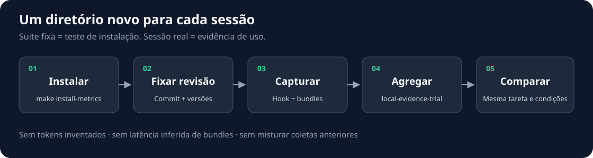

# Install in other repositories and collect trials

**English** · [Português (Brasil)](trials.pt-BR.md)

This guide separates three sources: the installation test (`fixed_suite`), the bundles from a
real session (`persisted_evidence`) and the work events (`make metrics`). They are different
signals. None of them, on its own, measures productivity, token savings or host security.



## 1. Install the tool in the target repository

In the ADF clone:

```bash
make install-metrics DEST=/absolute/path/other-repository
```

The command copies `ai-development-framework/` and creates `Makefile.adf`. It preserves the target's `Makefile`,
`AGENTS.md`, `.gitignore`, `VERSION`, `LICENSE`, Python environments and agent
configurations. It does not install dependencies, does not enable hooks, does not commit and does not access the network.
Events, bundles, trials, caches, `.env*` files, old proposals and historical rows
of the CSVs are not carried into the new project. The ADF MIT license stays inside the core;
the target project's license stays the same.

The target must exist and must be outside the ADF clone. An existing installation or a symlink
at `ai-development-framework` or `Makefile.adf` causes an error before the copy. Updates
must be reviewed as a diff; the command does not overwrite a previous installation.
`install-into` is still the full harness installation, but it now refuses conflicts
with project files. To collect metrics in an existing repo, use `install-metrics`.

In the target, prepare an environment separate from the application environment:

```bash
cd /absolute/path/other-repository
python3 -m venv .venv-adf
export ADF_CONTRACTS_PYTHON="$PWD/.venv-adf/bin/python3"
make -f Makefile.adf install-dev
"$ADF_CONTRACTS_PYTHON" -c 'import tools, runtime, integration; print("ok")'
```

Alternative with uv: `uv venv --python python3 .venv-adf`, followed by
`uv pip install --python .venv-adf/bin/python3 -e ./ai-development-framework -r ai-development-framework/requirements-test.txt`.
Export `ADF_CONTRACTS_PYTHON` as above for the following commands.
Python 3.10+, Git and Make are required; the exact dependency pins live in `ai-development-framework/requirements-test.txt`.
Bash 4+ is required for the full gates, not for the Python trial runner.

<a id="validar-a-instalação-portátil"></a>
### Validate the portable installation

In the target, run `make -f Makefile.adf quality` and `make -f Makefile.adf eval`
with `ADF_CONTRACTS_PYTHON` pointing to `.venv-adf/bin/python3`. For the application
gates, keep the application environment on the `PATH` and configure its test
dependencies, including an isolated database when needed. Use Bash 4+ on the `PATH`.
`ADF_EVAL_WRITE=0` preserves the historical results while running the checks.

The core self-tests always run, and any failure blocks the gate. Specs
required by the oracles ship with the copy in `ai-development-framework/docs/specs/`.
Tests use `Makefile.adf` to avoid depending on the targets of the application Makefile;
the ADF license is checked separately from the target's license.

The presence of a regular `Makefile.adf` identifies the portable installation for
the deployment check. Codex hooks and ADF workflows that are not installed are
explicitly `skipped`, without counting as green checks. Present files that are
invalid, workflows that diverge from the template and templates missing from the package
still fail. In the source clone, without `Makefile.adf`, a missing
deployment configuration is still a failure. `make test-all` (or
`make -f Makefile.adf test-all`) also runs this separate check.
None of these commands installs hooks or workflows automatically, and none proves
capture inside a real client.

Earlier installations must receive the reviewed files and the two packaged
specs before running these gates. Preserve local evidence and configuration
when updating; `install-metrics` still refuses to overwrite.

If you version the installation, include only the reviewed files. Add
`.venv-adf/` to the target's ignore policy before preparing any commit.
The `.gitignore` inside the core already excludes bundles, events, trajectories and trials.

## 2. Confirm the installation with the fixed suite

The target must be a Git repository with at least one commit and a `README.md` tracked
at the `HEAD` revision. The runner prepares snapshots of that revision; uncommitted files
do not enter the controlled read. If your README has a different name, run the test in the ADF
clone and use the real capture in the target, without reading that difference as a gate failure.

```bash
make -f Makefile.adf local-evidence-trial \
  TRIAL_ID="smoke-$(date -u +%Y%m%dT%H%M%SZ)"
```

Expected result on suite 1.0:

| Case | Result |
| --- | --- |
| README read | `delivered/read_delivered` |
| Sensitive path | `deny/sensitive_path_denied` |
| Traversal | `deny/invalid_referenced_contract` |
| Different binding at the PDP | `deny/run_binding_mismatch` |
| Different binding at the PEP | `deny/task_ref_mismatch` |

That is **5 attempts, 4 bundles, 3 valid bundles and 1 invalid**. The invalid bundle from the
PDP case is expected: the denial happens before any `effective_scope` exists. The traversal
produces no bundle. Therefore, `decisions_total=3`, `admit_read_total=3` and `deny_total=0`
do not mean that the four denials did not happen. Read `reason_codes` as well.
The binding mismatch cases are injected by the test; they are not production incidents.

The suite uses the runner's own evidence directory. Do not aggregate that directory
as if it were a user session. An expectation failure returns an error; preserve
the report for diagnosis. Repeated IDs do not overwrite reports.

## 3. Prepare a real capture

Use a task identified by a code, without names of people, customers or prompts.
For each session, run in the target, in the same terminal that will start the agent:

```bash
export ADF_CONTRACTS_PYTHON="$PWD/.venv-adf/bin/python3"
export ADF_TRUSTED_REPOSITORY="$(pwd -P)"
export ADF_TRUSTED_REVISION="$(git rev-parse HEAD)"
export ADF_MAX_OUTPUT_BYTES=1048576
export TRIAL_ID="session-$(date -u +%Y%m%dT%H%M%SZ)-01"
export ADF_EVIDENCE_DIR="$ADF_TRUSTED_REPOSITORY/ai-development-framework/docs/observability/evidence/$TRIAL_ID"
umask 077
mkdir -p "$(dirname "$ADF_EVIDENCE_DIR")"
mkdir "$ADF_EVIDENCE_DIR"
```

The last `mkdir` must succeed: if the directory already exists, choose another ID before
starting. Do not use `mkdir -p` to reuse the session folder. Pinning the SHA prevents
the meaning of `HEAD` from changing during collection. The gate controls a read of the
pinned snapshot; the agent's next native read may observe the working tree.
Keep the revision and the test file stable during the initial check.

Record alongside the results the target revision SHA, the SHA/version of the ADF used, the agent
version, model, configuration, task code, time and success criteria.
The aggregate report **does not include all of this metadata**. Keep that record
separately, locally, without physical paths, file contents, prompts or credentials.
In comparisons, keep the task and snapshot the same and record any change.

<a id="4-habilitar-o-hook-de-leitura"></a>
## 4. Enable the read hook

`install-metrics` does not change agent configuration. Merge one of the blocks below
into the existing configuration; preserve the other hooks. Replace `ABS_DEST` with the absolute
path of the target. Paths with spaces must stay quoted in the command.
Restart the agent from the terminal that holds the exports from the previous step.

### Claude Code

In `.claude/settings.local.json`, use the `Read` matcher:

```json
{
  "hooks": {
    "PreToolUse": [{
      "matcher": "Read",
      "hooks": [{
        "type": "command",
        "command": "\"ABS_DEST/.venv-adf/bin/python3\" \"ABS_DEST/ai-development-framework/hooks/claude-code-read-gate.py\""
      }]
    }]
  }
}
```

### Codex

In `.codex/hooks.json`, use the P4 hook contract tested in this project:

```json
{
  "hooks": {
    "PreToolUse": [{
      "matcher": "^Bash$",
      "hooks": [{
        "type": "command",
        "command": "\"ABS_DEST/.venv-adf/bin/python3\" \"ABS_DEST/ai-development-framework/hooks/codex-bash-read-gate.py\"",
        "timeout": 30,
        "statusMessage": "Checking ADF read policy"
      }]
    }]
  }
}
```

Review/trust the hook in `/hooks` before collecting. We call Python directly because
the clone's wrapper expects `.venv`, while this guide uses `.venv-adf`.
Support depends on the agent version; the P4 limits are in
[CONTROL_PLANE](CONTROL_PLANE.md#codex-bash-read-equivalent-p4).
**Only an allowlisted `cat file` is measured in Codex.** `rg`, Python, compound commands
and other tools have no such coverage. Cursor receives the harness, but has no evidence
adapter implemented here.

### Many projects, one hook (REQ-MP-01)

To use the gate in other repositories without installing ADF in each one (and without installing it in the parent folder:
Claude Code does not inherit `.claude/` from parent folders, and `install-metrics` refuses a target that contains
the clone), register the wrapper **once** in the global settings and enable projects in a host list:

```jsonc
// ~/.claude/settings.json — append to the hooks.PreToolUse array; the other hooks keep running (they add up)
{ "matcher": "Read", "hooks": [{ "type": "command", "timeout": 30,
  "command": "H=/abs/agent-effect-security/ai-development-framework/hooks/adf-read-hook.py; P=/abs/agent-effect-security/.venv/bin/python3; [ -f \"$H\" ] && [ -x \"$P\" ] || exit 0; exec \"$P\" \"$H\"" }] }
```

Simpler: `adf hook-snippet claude` (or `codex`) prints this block already filled in with this clone's paths and the
fail-safe, for the `Read` and `Bash` matchers ([ADR 0025](architecture-decision-records/0025-adf-operator-cli.md)).

The `[ -f … ] || exit 0` test is mandatory: if the clone switches to a branch without the wrapper, Python exits with
code 2, and in `PreToolUse` code 2 **blocks** the tool, that is, every `Read` in every project.

The same wrapper serves Codex: register it in Codex's global hooks file (`~/.codex/hooks.json` in
0.157.0; confirm the path in the installed version, `na` in the trials) with `matcher: "^Bash$"` and the same
command line with the fail-safe. The hook identifies the project by the `cwd` that Codex sends in the payload (Claude exports
`CLAUDE_PROJECT_DIR`) and applies the P4 gate: only an allowlisted `cat PATH` gets a decision (`{}` = delivered, deny with
`reason_code`); any other command returns `{}` and follows the Codex policy. Same list, same git
root, same evidence folder as Claude. Codex is not coverage of all file access: `head`, `sed`,
`rg`, pipes and redirections stay outside, as in P4.

```bash
make project-enable PROJECT=/home/you/dev/MY_PROJECT   # canonical absolute path; git root recommended
make projects                                             # lists each entry and how the hook will treat it
make project-disable PROJECT=/home/you/dev/MY_PROJECT
make project-reasons                                      # per project: bundles, journal attempts (includes contract denies without a bundle) and, per principal, attempts/delivered/denied/paths_read
make project-reasons POLICY=/abs/host-policy.json         # adds granted/unused per principal from the pinned policy (ADR 0024)
```

The targets call `hooks/adf-projects.py`, which applies the same rules as the hook: a path that is relative, contains `..`,
`//`, ends in `/` or is not a directory is refused (exit 1) and the list does not change; a symlink is stored by its
real path; a project outside git is accepted with a warning, because the gate will deny there (`project_not_git`). Hand-written
lines that are not canonical stay in the file and show up as `ignored`. Editing the file
directly is still valid (one line per absolute path).

| Situation | Behavior |
| --- | --- |
| Project not in the list, list missing or unreadable, no `CLAUDE_PROJECT_DIR` and no `cwd` in the payload | No decision: the agent follows its normal permissions |
| Line that is relative, contains `..` or `//`, or ends in `/` | Ignored (enables nothing) |
| Listed project that is a git repository (including when opened in a subfolder) | Clone gate, with root = the project's git top level; an `ADF_TRUSTED_REPOSITORY` exported for another repo is overridden |
| Listed project without git | `deny project_not_git` (the gate only reads a git snapshot) |
| Listed project and internal failure, malformed payload or tool other than `Read`/`Bash` | `deny adapter_failed` / `unsupported_tool` (fail closed) |

Evidence goes to `~/.adf/evidence/<project>-<hash>/<YYYY-MM-DD>/<session_id>/`, outside the project's
repo. Revision, budget, pinned policy (`ADF_READ_POLICY_*`) and OTel (`ADF_OTEL_*`) come from the environment
Claude was opened from, if exported; otherwise `HEAD`, 1 MiB, demo mode and OTel off. The hook only applies
to sessions opened after registration. Each read registers and removes a temporary worktree in the project's
`.git/worktrees/`; no file in the working tree is touched.

Residuals: the agent can edit `~/.adf/enabled-projects` via `Bash` or run `make project-enable` (the list only
keeps the on/off switch outside the workspace; it is not protected); in an enabled project the gate's limits apply (an uncommitted
file, a binary or a file above the budget is denied; in Claude, `Bash`/`Grep`/`Glob` stay outside; in Codex only `cat PATH`
gets a decision).

### Who read: subagents in the evidence (ADR 0023)

Inside a Claude Code subagent the hook receives `agent_type`; from it the gate derives a local principal
(`claude:security-reviewer`, or `claude:main` in the main thread; `codex:…` in Codex) that goes to the PDP and the
PEP, to the `_attempts` journal (`principal_sub`) and to the span (`adf.agent_type`). The bundle does not change. A malformed
`agent_type` is `deny invalid_principal`. On its own it is a label; per-principal policy is the next slice.

### Token in the host process, never in the prompt (A2A client)

For an agent that needs to read through the A2A edge, do not paste the bearer token into the prompt or export it where the agent can run
`echo`. Register the MCP client `integration/mcp_a2a_client.py` as the agent's stdio server: it holds the token and
exposes a single tool, `read_via_adf(path)`. The model sees only the path and the result; AuthN, AuthZ, PDP, PEP and evidence
stay in the gateway.

```jsonc
// MCP server in Claude/Codex; the environment belongs to the host, the agent does not see it
{ "command": "/abs/agent-effect-security/.venv/bin/mcp", "args": ["run", "/abs/agent-effect-security/ai-development-framework/integration/mcp_a2a_client.py:mcp", "--transport", "stdio"],
  "env": { "ADF_A2A_URL": "http://127.0.0.1:8765/", "ADF_A2A_TOKEN_FILE": "/home/USER/.adf/pilot/token-agent.txt" } }
```

Client rules: `ADF_A2A_TOKEN_FILE` absolute, a regular file, mode `0600` (group/other readable or a symlink →
`host_configuration_invalid`); `ADF_A2A_URL` only on `127.0.0.1` (TLS goes through a host proxy, A2A-8a). Delivered returns
the text; deny returns `ToolError(reason_code)`; a pause returns `input_required task=<id> effect_binding=<digest>` and
**there is no confirmation tool**: the human confirms with a `human:confirm` token that this process never holds.
Residual: an agent that someone hands a token to can still use `curl` through `Bash`; the client removes the need for the
anti-pattern, not the possibility. Test: `bash ai-development-framework/hooks/test-mcp-a2a-client.sh`.

## 5. Verify the capture and run the task

Read a public, tracked and stable file: `Read` in Claude or
`cat README.md` in Codex. A bundle JSON must appear under `ADF_EVIDENCE_DIR`.
A permission granted by the agent without a bundle does not prove instrumentation.
Do not test with real secrets. Do the initial check in a separate session and
open a new directory/ID for the measured task, so you do not contaminate your counts.

During the task, record the work hand-offs separately:

```bash
make -f Makefile.adf observability-record \
  TASK="$TRIAL_ID" ARCHETYPE=Builder PHASE=build \
  TOKENS_IN=na TOKENS_OUT=na BUDGET_REMAINING=na DURATION_SECONDS=na

# Run the task in the agent and the project's relevant tests.
# When done, use the observed result: success, failure or skipped.
make -f Makefile.adf observability-complete \
  TASK="$TRIAL_ID" ARCHETYPE=Builder PHASE=review OUTCOME=success \
  TOKENS_IN=na TOKENS_OUT=na BUDGET_REMAINING=na DURATION_SECONDS=na
make -f Makefile.adf metrics
```

Replace `na` with numbers only when there is a runtime count. Count each interval
once; do not repeat the cumulative total in every hand-off. Duration and cost are values
supplied by the collector, not measured automatically by these commands. `make metrics`
summarizes the whole local history, while the trial report aggregates only the chosen folder.
RTK can supply its separate report via `rtk gain`, but the tool's global history
must not be attributed automatically to this task.

## 6. Aggregate only the closed session

Close the agent session before aggregating; avoid new bundles while the directory
is being read. In the same terminal, confirm that the folder contains JSON files:

```bash
"$ADF_CONTRACTS_PYTHON" -c 'import os; from pathlib import Path; count = len(list(Path(os.environ["ADF_EVIDENCE_DIR"]).rglob("*.json"))); print("bundles:", count); assert count > 0, "empty capture"'
make -f Makefile.adf local-evidence-trial \
  EVIDENCE_DIR="$ADF_EVIDENCE_DIR" TRIAL_ID="$TRIAL_ID"
```

The report is written to `ai-development-framework/docs/observability/trials/$TRIAL_ID.json`.
This source must have `source.kind=persisted_evidence` and `source.latency_recorded=false`.
The CLI output is a summary; the JSON holds the verified aggregate and its `report_sha256`.
An empty capture can produce a valid aggregate; the `assert` above prevents reading it
as an executed trial. The aggregate does not reconstruct attempts that failed before persisting
a bundle; also keep a local record of the count of instrumentation failures.

### Share only the aggregate on another branch

In the repository where the trial ran, after closing the session and
generating the report above, review the JSON locally. Use a `TRIAL_ID` without names
of people, customers or other private information. Reports generated in
`docs/observability/trials/` are ignored by Git; copy **only the aggregate**
to a tracked folder and publish a dedicated branch:

```bash
git status --short
git switch -c "trial/$TRIAL_ID"
mkdir -p docs/trial-results
cp "ai-development-framework/docs/observability/trials/$TRIAL_ID.json" "docs/trial-results/$TRIAL_ID.json"
git add "docs/trial-results/$TRIAL_ID.json"
git diff --cached --check
git commit -m "data(trial): add aggregate $TRIAL_ID"
git push -u origin "trial/$TRIAL_ID"
```

If the installation lives in another repository, the branch above belongs to **that**
repository. To share in the ADF repository, copy the aggregate JSON
into an ADF clone and create the branch there. Review the metadata and the diff before
the push; do not version `evidence/`, `_attempts/`, logs, prompts, `.env` or
read content. The v1 `persisted_evidence` report contains filler
zeros in `metrics.decision_latency_ms`; `source.latency_recorded=false`
means those latencies **were not measured**. The
[approved](../../docs/specs/p0d-trial-sessions.md) P0-D contract fixes this without changing
the v1 files.

### P0-D session report (v2)

With the P0-D version installed, provide the agent's `session_id` (the same
`run_id` in the P0-A journals; it may differ from `TRIAL_ID`) and a task code
without PII. The session must be closed:

```bash
make -f Makefile.adf local-session-trial EVIDENCE_DIR="$ADF_EVIDENCE_DIR" \
  TRIAL_ID="$TRIAL_ID" TASK_ID="task-01" SESSION_ID="$SESSION_ID"
```

In the ADF clone, use `make local-session-trial` with the same parameters. The
aggregate report is written to
`ai-development-framework/docs/observability/trials/$TRIAL_ID-$SESSION_ID.v2.json`.
To publish it, copy **that file** instead of the v1 `.json` in the commands above.
v2 distinguishes attempts, bundles and session; durations from historical evidence
stay `null`, and `task_outcome` stays
`null` until external evaluation. `coverage=unknown` means that no verifiable
start was observed, not that zero attempts occurred.

The `_attempts` directory is shared across sessions. In the current v2,
`journal_other_session_total` counts intact journals from other sessions;
`journal_duplicates_total` and `bundle_duplicates_total` count verified copies
without increasing attempts or decisions. Invalid bindings stay invalid.
Conflicting journals for the same attempt make its capture `invalid`,
regardless of file order. `journal_files_total` includes the files
inspected from all sessions, so it is not the attempt denominator.
`decisions.total` counts distinct verified bundles, including orphans;
`decisions.runtime_delivered`/`runtime_denied` describe receipts, without proving
a return after cleanup or task success. The new fields are optional to
preserve reading of earlier v2 reports; a missing `decisions` means unknown.
To get these classifications for old captures, generate another report with
a new `TRIAL_ID`; the collector never overwrites existing reports.

<a id="registrar-proveniência-do-trial"></a>
### Record trial provenance

For new trials, provide the four provenance fields together:

```bash
make -f Makefile.adf local-session-trial EVIDENCE_DIR="$ADF_EVIDENCE_DIR" \
  TRIAL_ID="$TRIAL_ID" TASK_ID="task-01" SESSION_ID="$SESSION_ID" \
  AGENT_NAME="codex" AGENT_VERSION="$AGENT_VERSION" \
  REVISION_SHA="$ADF_WORKSPACE_REVISION" ACCEPTANCE_SHA256="$ACCEPTANCE_SHA256"
```

`AGENT_NAME` accepts `claude`, `codex`, `cursor` or `other`; the version must be
an identifier without spaces or paths, up to 128 characters. Use the real
client version, not the model version. `REVISION_SHA` is the full 40-character
lowercase Git SHA the host used in the capture, not `HEAD` or a branch name.
`ACCEPTANCE_SHA256` is the SHA-256 of the bytes of the acceptance document or reproducible
test, defined before the task and kept separately by the evaluator.
On macOS, `shasum -a 256 acceptance-file` computes that hash; only the hash goes into
the report. Do not put prompts, paths or criterion text in these fields.

The CLI also accepts `--agent-name`, `--agent-version`, `--revision-sha` and
`--acceptance-sha256`. If any field is provided, all are required;
invalid values fail before the report is persisted. Without all four, the
`provenance` field is absent, to preserve ingestion of old captures.
The report hash covers the metadata. These are host declarations, with no attestation
of the version, the revision or the test run; they do not authorize reads or demonstrate
success. `task_outcome` stays `null`: the collector does not run the external
evaluation. Review the identifiers before sharing the aggregate.

### Capture six-stage timings

In the P0-D version with instrumentation, the host can enable capture before
starting the agent or the MCP server:

```bash
export ADF_CAPTURE_TIMINGS=1
```

Claude `Read`, Codex `Bash` covered by the gate and MCP `read_snapshot` go
through the same observation. The option does not come from the agent payload. Capture writes
`_timings/<attempt_id>.json` separately, after the adapter's return/raise;
v1 journals and bundles stay intact. Unset the variable to return to the
previous behavior. The `local-session-trial` command collects the new files
without extra arguments, always with the session closed.

In v1 ingestion (`local-evidence-trial EVIDENCE_DIR=...`), reserved `_timings`
directories are excluded from bundle selection, including in nested session
folders. Their JSON files are separate P0-D observations, not invalid bundles.
Invalid files outside those directories are still counted. Earlier reports
are not rewritten; regenerate with another trial ID if they mixed timings
and bundles. v1 ingestion still has no latency measurements, even when there are
timings next to the bundles; use v2 for those measurements.

See `observations[].timing.durations_ms` and `timings.stages` in the report.
Each stage has the count, sum, minimum and maximum of the correlated samples;
`null` means absence and `0` a measurement below 1 ms. `timings.coverage=observed`
means samples exist, without guaranteeing complete coverage. `total` measures the adapter,
including the journal close, before the observation is exported; it does not measure
export, MCP transport, the model or the session duration. The top-level `durations_ms`
stays `null`: summing attempts does not produce session time.

An export failure emits `adf: timing_evidence_failed` on stderr and keeps the
read result. Partial files, symlinks and FIFOs are invalid. Hash,
run/attempt ID and start hash must verify before timings are correlated.
Conflicts do not enter the samples. Receipts, timings and `returned`/`raised` do not
prove consumption by the client or task success. See the
[limits and the contract](../integration/v2/README.md#monotonic-timings-p0-d-step-3-opt-in).

## 7. Interpret and compare without inflating results

| Field | Interpretation |
| --- | --- |
| `reads_total` | In the suite: attempts. In the persisted source: JSON files found, not every tool call in the session |
| `bundles_total` | Entries passed to aggregation, including invalid bundles |
| `evidence_bundle_valid_total` / `invalid_total` | Evidence that verifies / fails verification |
| `decisions_total` | Decisions from valid bundles; not the total attempt count |
| `admit_read_total` / `deny_total` | PDP decision; an admission can be denied by the PEP/runtime |
| `sensitive_path_denied_total` | Denial at the effect because of a sensitive path; can coexist with a PDP admission |
| `binding_mismatch_total` | Mismatches counted from valid evidence |
| `reason_codes` | Distribution of the collected outcomes, including suite failures |
| `decision_latency_ms` | Use only if `latency_recorded=true`; zeros from the persisted source are filler |
| Tokens/cost `na` or `null` | Not available; never zero or proven savings |

Repeat the same task under the same conditions in independent sessions. Separate smoke,
fixed suite and real work; identify failures, skips and version changes. To compare
productivity with/without ADF, also capture objective task success, duration, tokens and
cost for both conditions; read bundles do not provide that baseline. Report the
number of sessions and the spread, without turning a single run into a general gain.

Share only reviewed aggregates and the anonymous metadata needed for the comparison.
Do not publish raw bundles or whole observability directories: although they do not store
file contents, bundles may include scopes with relative file names.
`report_sha256` detects changes to the aggregate; it is not a signature and does not authenticate the collector.

## Diagnosis

| Symptom | Check |
| --- | --- |
| No bundles | Exports in the agent process, trusted hook, matcher and tool used |
| `host_configuration_invalid` | Absolute root/evidence, valid revision and positive budget |
| `workspace_revision_unavailable` | Commit exists in the target, Git accessible |
| `path_outside_trusted_root` | File inside the repo pinned by the host |
| `trial_evidence_dir_unavailable` | Correct directory, with read permission |
| `trial_execution_failed` when repeating an ID | Choose a new ID; reports use exclusive creation |
| Numbers lower than the attempts | Failures without a bundle, invalid bundles and tools outside the matcher |

See [control plane limits](CONTROL_PLANE.md), [events and trajectories](observability/README.md)
and [metrics schemas](../integration/v1/README.md). No command in this guide deploys,
publishes a package or sends data to a service.

## External task evaluation

The v2 session collector keeps `task_outcome: null`. To record the result
of an external evaluation, use the independent `task-evaluation` 1.0 contract and the
`build_task_evaluation` / `verify_task_evaluation` functions from
`integration.task_evaluation`. The session must have complete provenance.

The evaluator must check the acceptance criterion identified in the session,
run the evaluation at the declared revision and preserve the result artifact.
Pass its SHA-256 as `result_sha256`, an evaluator identifier and version,
`evaluated_revision_sha`, a UTC `created_at` and `task_outcome` (`success` or
`failure`). For an evaluation that was not run, declare `skipped` and pass
`result_sha256=None`. Keep the record separately and validate it together with the original
session; never replace its v2 report.

The record contains hashes and identifiers, without test output, personal names
or paths. Verification confirms integrity and binding, not the authenticity
of the evaluator or the truth of the result. Running checks and human review
remain external. No evaluation was attributed to the host probe of an external repository.
